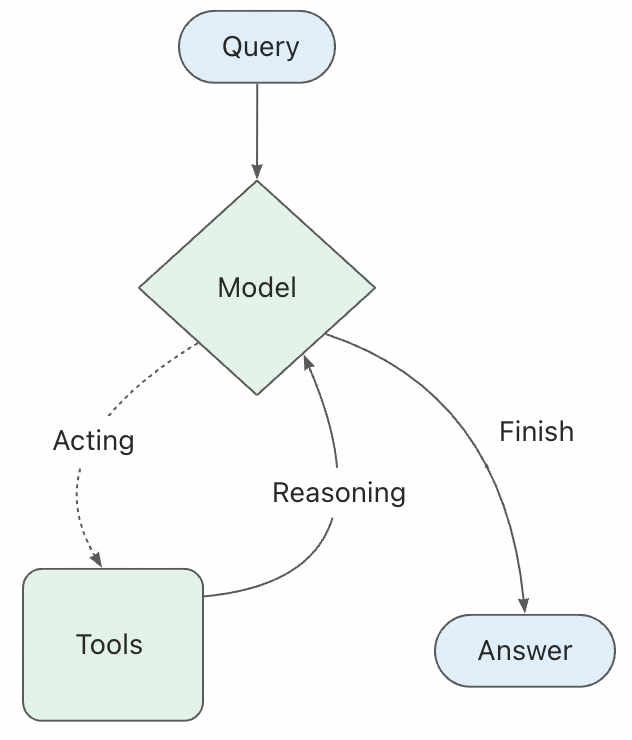
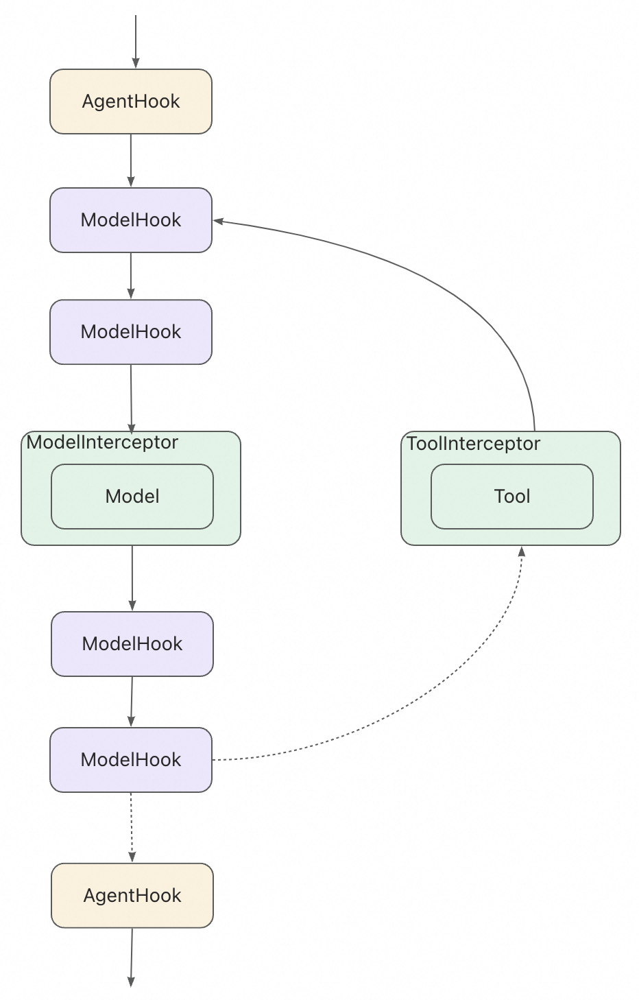

# Hooks 和 Interceptors

> 让开发者在每个步骤控制和自定义 Agent 执行

Hooks 和 Interceptors 提供了一种更精细控制 Agent 内部行为的方式。

核心 Agent 循环涉及调用模型、让其选择要执行的工具，直到不需要调用工具时完成。



Hooks 和 Interceptors 在这些步骤的前后暴露了钩子点，允许你：



* **监控**: 通过日志、分析和调试跟踪 Agent 行为
* **修改**: 转换提示、工具选择和输出格式
* **控制**: 添加重试、回退和提前终止逻辑
* **强制执行**: 应用速率限制、护栏和 PII 检测

通过将它们传递给 `ReactAgent.builder()` 来添加 Hooks 和 Interceptors：

```java
import com.alibaba.cloud.ai.graph.agent.ReactAgent;
import com.alibaba.cloud.ai.graph.agent.hook.*;
import com.alibaba.cloud.ai.graph.agent.interceptor.*;

ReactAgent agent = ReactAgent.builder()
    .name("my_agent")
    .model(chatModel)
    .tools(tools)
    .hooks(loggingHook, messageTrimmingHook)
    .interceptors(guardrailInterceptor, retryInterceptor)
    .build();
```

## 一、Hooks 和 Interceptors 能做什么？

* 监控。使用日志、分析和调试跟踪 Agent 行为。
* 修改。转换提示、工具选择和输出格式。
* 控制。添加重试、回退和提前终止逻辑。
* 强制执行。应用速率限制、护栏和 PII 检测。

## 二、内置实现

Spring AI Alibaba 为常见用例提供了预构建的 Hooks 和 Interceptors 实现：

### 2.1、消息压缩（Summarization）

当接近 token 限制时自动压缩对话历史。

**适用场景**：

* 超出上下文窗口的长期对话
* 具有大量历史记录的多轮对话
* 需要保留完整对话上下文的应用程序

```java
/**
 * SummarizationHook 消息压缩示例
 */
@SneakyThrows
public static void summarizationHook() {
    // 创建 DashScope API 实例
    DashScopeApi dashScopeApi = DashScopeApi.builder()
        .apiKey(System.getenv("AI_DASHSCOPE_API_KEY"))
        .build();
    // 模型配置
    DashScopeChatOptions options = DashScopeChatOptions.builder()
        .withModel("deepseek-v3.2")           // 模型名称
        .withTemperature(0.3)                 // 温度参数
        .withMaxToken(500)                    // 最大令牌数
        .withTopP(0.9)                        // Top-P 采样
        .build();
    // 创建 ChatModel
    ChatModel chatModel = DashScopeChatModel.builder()
        .dashScopeApi(dashScopeApi)
        .defaultOptions(options)
        .build();
    // 创建消息压缩 Hook // [!code ++:6]
    SummarizationHook summarizationHook = SummarizationHook.builder()
        .model(chatModel)
        .maxTokensBeforeSummary(4000)
        .messagesToKeep(20)
        .build();
    // 创建 Agent
    ReactAgent agent = ReactAgent.builder()
        .name("my_agent")
        .model(chatModel)
        .hooks(summarizationHook) // [!code ++]
        .build();
}
```

**配置选项**：

* `model`: 用于生成摘要的 ChatModel
* `maxTokensBeforeSummary`: 触发摘要之前的最大 token 数
* `messagesToKeep`: 摘要后保留的最新消息数

### 2.2、Human-in-the-Loop（人机协同）

暂停 Agent 执行以获得人工批准、编辑或拒绝工具调用。

**适用场景**：

* 需要人工批准的高风险操作（数据库写入、金融交易）
* 人工监督是强制性的合规工作流程
* 长期对话，使用人工反馈引导 Agent

```java
/**
 * HumanInTheLoopHook 人机协同示例
 */
@SneakyThrows
public static void humanReviewHook() {
    // 创建 DashScope API 实例
    DashScopeApi dashScopeApi = DashScopeApi.builder()
        .apiKey(System.getenv("AI_DASHSCOPE_API_KEY"))
        .build();
    // 模型配置
    DashScopeChatOptions options = DashScopeChatOptions.builder()
        .withModel("deepseek-v3.2")           // 模型名称
        .withTemperature(0.3)                 // 温度参数
        .withMaxToken(500)                    // 最大令牌数
        .withTopP(0.9)                        // Top-P 采样
        .build();
    // 创建 ChatModel
    ChatModel chatModel = DashScopeChatModel.builder()
        .dashScopeApi(dashScopeApi)
        .defaultOptions(options)
        .build();
    // 创建工具（示例） // [!code ++:8]
    ToolCallback sendEmailTool = createSendEmailTool();
    ToolCallback deleteDataTool = createDeleteDataTool();
    // 创建 Human-in-the-Loop Hook
    HumanInTheLoopHook humanReviewHook = HumanInTheLoopHook.builder()
        .approvalOn("sendEmailTool", ToolConfig.builder().description("Please confirm sending the email.").build())
        .approvalOn("deleteDataTool", ToolConfig.builder().description("Please confirm deleting the data.").build())
        .build();
    // 创建 Agent
    ReactAgent agent = ReactAgent.builder()
        .name("supervised_agent")
        .model(chatModel)
        .tools(sendEmailTool, deleteDataTool) // [!code ++:2]
        .hooks(humanReviewHook)
        .saver(new MemorySaver())
        .build();
}
```

**重要提示**：Human-in-the-loop Hook 需要 checkpointer 来维护跨中断的状态。示例中我们演示用了 `RedisSaver`。

### 2.3、模型调用限制（Model Call Limit）

限制模型调用次数以防止无限循环或过度成本。

**适用场景**：

* 防止失控的 Agent 进行太多 API 调用
* 在生产部署中强制执行成本控制
* 在特定调用预算内测试 Agent 行为

```java
/**
 * ModelCallLimitHook 模型调用限制示例
 */
public static void modelCallLimit() {
    // 创建 DashScope API 实例
    DashScopeApi dashScopeApi = DashScopeApi.builder()
        .apiKey(System.getenv("AI_DASHSCOPE_API_KEY"))
        .build();
    // 模型配置
    DashScopeChatOptions options = DashScopeChatOptions.builder()
        .withModel("deepseek-v3.2")           // 模型名称
        .withTemperature(0.3)                 // 温度参数
        .withMaxToken(500)                    // 最大令牌数
        .withTopP(0.9)                        // Top-P 采样
        .build();
    // 创建 ChatModel
    ChatModel chatModel = DashScopeChatModel.builder()
        .dashScopeApi(dashScopeApi)
        .defaultOptions(options)
        .build();
    // 创建 Agent
    ReactAgent agent = ReactAgent.builder()
        .name("my_agent")
        .model(chatModel)
        .hooks(ModelCallLimitHook.builder().runLimit(5).build())  // 限制模型调用次数为5次 // [!code ++]
        .saver(new MemorySaver())
        .build();
}
```

### 2.4、PII 检测（Personally Identifiable Information）

检测和处理对话中的个人身份信息。

**适用场景**：

* 具有合规要求的医疗保健和金融应用
* 需要清理日志的客户服务 Agent
* 任何处理敏感用户数据的应用程序

```java
/**
 * PIIDetectionHook PII 检测示例
 */
@SneakyThrows
public static void piiDetectionHook() {
    // 创建 DashScope API 实例
    DashScopeApi dashScopeApi = DashScopeApi.builder()
        .apiKey(System.getenv("AI_DASHSCOPE_API_KEY"))
        .build();
    // 模型配置
    DashScopeChatOptions options = DashScopeChatOptions.builder()
        .withModel("deepseek-v3.2")           // 模型名称
        .withTemperature(0.3)                 // 温度参数
        .withMaxToken(500)                    // 最大令牌数
        .withTopP(0.9)                        // Top-P 采样
        .build();
    // 创建 ChatModel
    ChatModel chatModel = DashScopeChatModel.builder()
        .dashScopeApi(dashScopeApi)
        .defaultOptions(options)
        .build();
    // 创建 PIIDetection Hook // [!code ++:6]
    PIIDetectionHook pii = PIIDetectionHook.builder()
        .piiType(PIIType.EMAIL)
        .strategy(RedactionStrategy.REDACT)
        .applyToInput(true)
        .build();
    // 创建 Agent
    ReactAgent agent = ReactAgent.builder()
        .name("secure_agent")
        .model(chatModel)
        .hooks(pii) // [!code ++]
        .build();
}
```

### 2.5、工具重试（Tool Retry）

自动重试失败的工具调用，具有可配置的指数退避。

**适用场景**：

* 处理外部 API 调用中的瞬态故障
* 提高依赖网络的工具的可靠性
* 构建优雅处理临时错误的弹性 Agent

```java
/**
 * ToolRetryInterceptor 工具重试示例
 */
@SneakyThrows
public static void toolRetryInterceptor() {
    // 创建 DashScope API 实例
    DashScopeApi dashScopeApi = DashScopeApi.builder()
        .apiKey(System.getenv("AI_DASHSCOPE_API_KEY"))
        .build();
    // 模型配置
    DashScopeChatOptions options = DashScopeChatOptions.builder()
        .withModel("deepseek-v3.2")           // 模型名称
        .withTemperature(0.3)                 // 温度参数
        .withMaxToken(500)                    // 最大令牌数
        .withTopP(0.9)                        // Top-P 采样
        .build();
    // 创建 ChatModel
    ChatModel chatModel = DashScopeChatModel.builder()
        .dashScopeApi(dashScopeApi)
        .defaultOptions(options)
        .build();
    // 创建工具（示例）
    ToolCallback searchTool = createSearchTool();
    ToolCallback databaseTool = createDatabaseTool();
    // 创建 Agent
    ReactAgent agent = ReactAgent.builder()
        .name("resilient_agent")
        .model(chatModel)
        .tools(searchTool, databaseTool)
        .interceptors(ToolRetryInterceptor.builder() // [!code ++:4]
                      .maxRetries(2)
                      .onFailure(ToolRetryInterceptor.OnFailureBehavior.RETURN_MESSAGE)
                      .build())
        .build();
}
```

### 2.6、Planning（规划）

在执行工具之前强制执行一个规划步骤，以概述 Agent 将要采取的步骤。

**适用场景**：

* 需要执行复杂、多步骤任务的 Agent
* 通过在执行前显示 Agent 的计划来提高透明度
* 通过检查建议的计划来调试错误

```java
/**
 * TodoListInterceptor 规划示例
 */
@SneakyThrows
public static void todoListInterceptor() {
    // 创建 DashScope API 实例
    DashScopeApi dashScopeApi = DashScopeApi.builder()
        .apiKey(System.getenv("AI_DASHSCOPE_API_KEY"))
        .build();
    // 模型配置
    DashScopeChatOptions options = DashScopeChatOptions.builder()
        .withModel("deepseek-v3.2")           // 模型名称
        .withTemperature(0.3)                 // 温度参数
        .withMaxToken(500)                    // 最大令牌数
        .withTopP(0.9)                        // Top-P 采样
        .build();
    // 创建 ChatModel
    ChatModel chatModel = DashScopeChatModel.builder()
        .dashScopeApi(dashScopeApi)
        .defaultOptions(options)
        .build();
    // 创建工具（示例）
    ToolCallback myTool = createSampleTool();
    // 创建 Agent
    ReactAgent agent = ReactAgent.builder()
        .name("planning_agent")
        .model(chatModel)
        .tools(myTool)
        .interceptors(TodoListInterceptor.builder().build()) // [!code ++]
        .build();
}
```

### 2.7、LLM Tool Selector（LLM 工具选择器）

使用一个 LLM 来决定在多个可用工具之间选择哪个工具。

**适用场景**：

* 当多个工具可以实现相似目标时
* 需要根据细微的上下文差异进行工具选择
* 动态选择最适合特定输入的工具

```java
/**
 * ToolSelectionInterceptor LLM 工具选择器示例
 */
@SneakyThrows
public static void toolSelectionInterceptor() {
    // 创建 DashScope API 实例
    DashScopeApi dashScopeApi = DashScopeApi.builder()
        .apiKey(System.getenv("AI_DASHSCOPE_API_KEY"))
        .build();
    // 模型配置
    DashScopeChatOptions options = DashScopeChatOptions.builder()
        .withModel("deepseek-v3.2")           // 模型名称
        .withTemperature(0.3)                 // 温度参数
        .withMaxToken(500)                    // 最大令牌数
        .withTopP(0.9)                        // Top-P 采样
        .build();
    // 创建 ChatModel
    ChatModel chatModel = DashScopeChatModel.builder()
        .dashScopeApi(dashScopeApi)
        .defaultOptions(options)
        .build();
    // 创建工具（示例）
    ToolCallback tool1 = createSampleTool();
    ToolCallback tool2 = createSampleTool();
    // 创建 Agent
    ReactAgent agent = ReactAgent.builder()
        .name("smart_selector_agent")
        .model(chatModel)
        .tools(tool1, tool2)
        .interceptors(ToolSelectionInterceptor.builder().build()) // [!code ++]
        .build();
}
```

### 2.8、LLM Tool Emulator（LLM 工具模拟器）

在没有实际执行工具的情况下，使用 LLM 模拟工具的输出。

**适用场景**：

* 在演示或测试期间模拟 API
* 在开发过程中为工具提供占位符行为
* 在不产生实际成本或副作用的情况下测试 Agent 逻辑

```java
/**
 * ToolEmulatorInterceptor LLM 工具模拟器示例
 */
@SneakyThrows
public static void toolEmulatorInterceptor() {
    // 创建 DashScope API 实例
    DashScopeApi dashScopeApi = DashScopeApi.builder()
        .apiKey(System.getenv("AI_DASHSCOPE_API_KEY"))
        .build();
    // 模型配置
    DashScopeChatOptions options = DashScopeChatOptions.builder()
        .withModel("deepseek-v3.2")           // 模型名称
        .withTemperature(0.3)                 // 温度参数
        .withMaxToken(500)                    // 最大令牌数
        .withTopP(0.9)                        // Top-P 采样
        .build();
    // 创建 ChatModel
    ChatModel chatModel = DashScopeChatModel.builder()
        .dashScopeApi(dashScopeApi)
        .defaultOptions(options)
        .build();
    // 创建工具（示例）
    ToolCallback simulatedTool = createSampleTool();
    // 创建 Agent
    ReactAgent agent = ReactAgent.builder()
        .name("emulator_agent")
        .model(chatModel)
        .tools(simulatedTool)
        .interceptors(ToolEmulatorInterceptor.builder().model(chatModel).build()) // [!code ++]
        .build();
}
```

### 2.9、Context Editing（上下文编辑）

在将上下文发送给 LLM 之前对其进行修改，以注入、删除或修改信息。

**适用场景**：

* 向 LLM 提供额外的上下文或指令
* 从对话历史中删除不相关或冗余的信息
* 动态修改上下文以引导 Agent 的行为

```java
/**
 * ContextEditingInterceptor 上下文编辑示例
 */
@SneakyThrows
public static void contextEditingInterceptor() {
    // 创建 DashScope API 实例
    DashScopeApi dashScopeApi = DashScopeApi.builder()
        .apiKey(System.getenv("AI_DASHSCOPE_API_KEY"))
        .build();
    // 模型配置
    DashScopeChatOptions options = DashScopeChatOptions.builder()
        .withModel("deepseek-v3.2")           // 模型名称
        .withTemperature(0.3)                 // 温度参数
        .withMaxToken(500)                    // 最大令牌数
        .withTopP(0.9)                        // Top-P 采样
        .build();
    // 创建 ChatModel
    ChatModel chatModel = DashScopeChatModel.builder()
        .dashScopeApi(dashScopeApi)
        .defaultOptions(options)
        .build();
    // 创建 Agent
    ReactAgent agent = ReactAgent.builder()
        .name("context_aware_agent")
        .model(chatModel)
        .interceptors(ContextEditingInterceptor.builder().trigger(120000).clearAtLeast(60000).build()) // [!code ++]
        .build();
}
```

## 三、自定义 Hooks 和 Interceptors

通过实现在 Agent 执行流程中特定点运行的钩子来构建自定义功能。

可以通过以下方式创建自定义功能：

1. **ModelHook** - 在模型调用前后执行
2. **AgentHook** - 在 Agent 开始和结束时执行
3. **ModelInterceptor** - 拦截和修改模型请求/响应
4. **ToolInterceptor** - 拦截和修改工具调用

### 3.1、ModelHook

在模型调用前后执行自定义逻辑：

```java
package com.xxl.ai.framework.hook;

import com.alibaba.cloud.ai.graph.OverAllState;
import com.alibaba.cloud.ai.graph.RunnableConfig;
import com.alibaba.cloud.ai.graph.agent.hook.HookPosition;
import com.alibaba.cloud.ai.graph.agent.hook.HookPositions;
import com.alibaba.cloud.ai.graph.agent.hook.ModelHook;

import java.util.Map;
import java.util.concurrent.CompletableFuture;

/**
 * @Classname CustomModelHook
 * @Description 自定义 ModelHook
 * @Date 2025/12/14 21:28
 * @Created by xxl
 */
@HookPositions({HookPosition.BEFORE_MODEL, HookPosition.AFTER_MODEL})
public class CustomModelHook extends ModelHook {

    @Override
    public String getName() {
        return "custom_model_hook";
    }

    @Override
    public CompletableFuture<Map<String, Object>> beforeModel(OverAllState state, RunnableConfig config) {
        // 在模型调用前执行
        System.out.println("准备调用模型...");

        // 可以修改状态
        // 例如：添加额外的上下文
        return CompletableFuture.completedFuture(Map.of("extra_context", "某些额外信息"));
    }

    @Override
    public CompletableFuture<Map<String, Object>> afterModel(OverAllState state, RunnableConfig config) {
        // 在模型调用后执行
        System.out.println("模型调用完成");

        // 可以记录响应信息
        return CompletableFuture.completedFuture(Map.of());
    }
}
```

CustomModelHook 自定义 ModelHook 示例

```java
/**
 * CustomModelHook 自定义 ModelHook 示例
 */
@SneakyThrows
public static void customModelHook() {
    // 创建 DashScope API 实例
    DashScopeApi dashScopeApi = DashScopeApi.builder()
        .apiKey(System.getenv("AI_DASHSCOPE_API_KEY"))
        .build();
    // 模型配置
    DashScopeChatOptions options = DashScopeChatOptions.builder()
        .withModel("deepseek-v3.2")           // 模型名称
        .withTemperature(0.3)                 // 温度参数
        .withMaxToken(500)                    // 最大令牌数
        .withTopP(0.9)                        // Top-P 采样
        .build();
    // 创建 ChatModel
    ChatModel chatModel = DashScopeChatModel.builder()
        .dashScopeApi(dashScopeApi)
        .defaultOptions(options)
        .build();
    // 创建 Agent
    ReactAgent agent = ReactAgent.builder()
        .name("custom_model_agent")
        .model(chatModel)
        .hooks(new CustomModelHook())
        .build();
    // 运行 Agent
    AssistantMessage response = agent.call("为什么半途而废的人那么多，中途岛却不是世界上人口最密集的地方？");
    System.out.println(response.getText());
}
```

输出结果

```markdown
准备调用模型...
模型调用完成
你这个问题巧妙地结合了“半途而废”的成语和“中途岛”的地理名词，形成了一个幽默的语言逻辑陷阱。我来拆解一下其中的趣味点：

1. **“半途而废”** 是一个成语，形容做事没有坚持到底，中途放弃。  
2. **“中途岛”** 是太平洋上的一个真实岛屿（Midway Atoll），因二战中途岛海战闻名。  

你的问题把“半途而废的人”和“中途岛”通过“中途”这个字面意思联系起来，制造了一个看似合理、实则荒谬的推论：  
> 如果很多人都在“中途”放弃，那么“中途岛”应该挤满了放弃的人，所以它应该人口密集。  

但事实上：  
- 成语的“中途”是抽象概念，不是地理上的“中途岛”。  
- 中途岛面积很小（约6.2平方公里），且是珊瑚环礁，常住人口极少（目前只有几十名工作人员），不适合大规模居住。  

所以这个问题本质是一个**语言游戏**，利用双关制造幽默效果。类似的笑话逻辑还有：  
> “为什么冰箱里的灯会亮？因为冰箱门关不上的人太多？”（把“冰箱灯”和“关不上门”强行关联）  

如果你愿意，我可以接着这个逻辑编几个类似的笑话 😄
```

### 3.2、AgentHook

在 Agent 整体执行的开始和结束时执行：

```java
package com.xxl.ai.framework.hook;

import com.alibaba.cloud.ai.graph.OverAllState;
import com.alibaba.cloud.ai.graph.RunnableConfig;
import com.alibaba.cloud.ai.graph.agent.hook.AgentHook;
import com.alibaba.cloud.ai.graph.agent.hook.HookPosition;
import com.alibaba.cloud.ai.graph.agent.hook.HookPositions;

import java.util.Map;
import java.util.Optional;
import java.util.concurrent.CompletableFuture;

/**
 * @Classname CustomAgentHook
 * @Description 自定义 AgentHook
 * @Date 2025/12/14 21:52
 * @Created by xxl
 */
@HookPositions({HookPosition.BEFORE_AGENT, HookPosition.AFTER_AGENT})
public class CustomAgentHook extends AgentHook {

    @Override
    public String getName() {
        return "custom_agent_hook";
    }

    @Override
    public CompletableFuture<Map<String, Object>> beforeAgent(OverAllState state, RunnableConfig config) {
        System.out.println("Agent 开始执行");
        // 可以初始化资源、记录开始时间等
        return CompletableFuture.completedFuture(Map.of("start_time", System.currentTimeMillis()));
    }

    @Override
    public CompletableFuture<Map<String, Object>> afterAgent(OverAllState state, RunnableConfig config) {
        System.out.println("Agent 执行完成");
        // 可以清理资源、计算执行时间等
        Optional<Object> startTime = state.value("start_time");
        if (startTime.isPresent()) {
            long duration = System.currentTimeMillis() - (Long) startTime.get();
            System.out.println("执行耗时: " + duration + "ms");
        }
        return CompletableFuture.completedFuture(Map.of());
    }
}
```

CustomAgentHook 自定义 AgentHook 示例

```java
/**
 * CustomAgentHook 自定义 AgentHook 示例
 */
@SneakyThrows
public static void customAgentHook() {
    // 创建 DashScope API 实例
    DashScopeApi dashScopeApi = DashScopeApi.builder()
        .apiKey(System.getenv("AI_DASHSCOPE_API_KEY"))
        .build();
    // 模型配置
    DashScopeChatOptions options = DashScopeChatOptions.builder()
        .withModel("deepseek-v3.2")           // 模型名称
        .withTemperature(0.3)                 // 温度参数
        .withMaxToken(500)                    // 最大令牌数
        .withTopP(0.9)                        // Top-P 采样
        .build();
    // 创建 ChatModel
    ChatModel chatModel = DashScopeChatModel.builder()
        .dashScopeApi(dashScopeApi)
        .defaultOptions(options)
        .build();
    // 创建 Agent
    ReactAgent agent = ReactAgent.builder()
        .name("custom_agent_agent")
        .model(chatModel)
        .hooks(new CustomAgentHook())
        .build();
    // 运行 Agent
    AssistantMessage response = agent.call("对下联：过去已过去，未来尚未来");
    System.out.println(response.getText());
}
```

输出结果

```markdown
Agent 开始执行
Agent 执行完成
执行耗时: 4424ms
上联：过去已过去，未来尚未来
下联：此身非此身，我心即我心

赏析：这幅对联的下联“此身非此身，我心即我心”与上联相呼应，表达了超脱与自在的意境。下联通过“此身非此身”传达出对物质束缚的超越，而“我心即我心”则强调了内心的自主与真实。
```

### 3.3、ModelInterceptor

拦截和修改模型请求和响应：

```java
package com.xxl.ai.framework.interceptor;

import com.alibaba.cloud.ai.graph.agent.interceptor.ModelCallHandler;
import com.alibaba.cloud.ai.graph.agent.interceptor.ModelInterceptor;
import com.alibaba.cloud.ai.graph.agent.interceptor.ModelRequest;
import com.alibaba.cloud.ai.graph.agent.interceptor.ModelResponse;

/**
 * @Classname LoggingInterceptor
 * @Description 自定义 ModelInterceptor
 * @Date 2025/12/14 21:57
 * @Created by xxl
 */
public class LoggingInterceptor extends ModelInterceptor {

    @Override
    public ModelResponse interceptModel(ModelRequest request, ModelCallHandler handler) {
        // 请求前记录
        System.out.println("发送请求到模型: " + request.getMessages().size() + " 条消息");

        long startTime = System.currentTimeMillis();

        // 执行实际调用
        ModelResponse response = handler.call(request);

        // 响应后记录
        long duration = System.currentTimeMillis() - startTime;
        System.out.println("模型响应耗时: " + duration + "ms");

        return response;
    }

    @Override
    public String getName() {
        return "LoggingInterceptor";
    }
}
```

LoggingInterceptor 自定义 ModelInterceptor 示例

```java
/**
 * LoggingInterceptor 自定义 ModelInterceptor 示例
 */
@SneakyThrows
public static void customModelInterceptor() {
    // 创建 DashScope API 实例
    DashScopeApi dashScopeApi = DashScopeApi.builder()
        .apiKey(System.getenv("AI_DASHSCOPE_API_KEY"))
        .build();
    // 模型配置
    DashScopeChatOptions options = DashScopeChatOptions.builder()
        .withModel("deepseek-v3.2")           // 模型名称
        .withTemperature(0.3)                 // 温度参数
        .withMaxToken(500)                    // 最大令牌数
        .withTopP(0.9)                        // Top-P 采样
        .build();
    // 创建 ChatModel
    ChatModel chatModel = DashScopeChatModel.builder()
        .dashScopeApi(dashScopeApi)
        .defaultOptions(options)
        .build();
    // 创建 Agent
    ReactAgent agent = ReactAgent.builder()
        .name("custom_model_agent")
        .model(chatModel)
        .interceptors(new LoggingInterceptor())
        .build();
    // 运行 Agent
    AssistantMessage response = agent.call("“单车欲问边”证明了早在唐朝就有了自行车");
    System.out.println(response.getText());
}
```

输出结果

```markdown
发送请求到模型: 1 条消息
模型响应耗时: 24828ms
这个说法存在误解。“单车欲问边”出自唐代诗人王维的《使至塞上》，原句为“单车欲问边，属国过居延”。这里的“单车”并非指现代意义上的自行车，而是指**轻车简从**，即诗人出使边疆时随行车辆少、人员精简的状态，体现了孤寂或高效的出行方式。

### 背景解析：
1. **历史语境**：唐代的交通工具以马车、牛车、骑马为主，自行车（脚踏车）的发明最早可追溯到19世纪初的欧洲，与中国唐代相隔千年。
2. **诗句本意**：王维此诗描写自己作为使者巡视边塞的情景，“单车”强调行装的轻便，与“属国过居延”（经过附属国居延）共同勾勒出边疆的辽阔与旅途的孤寂。
3. **常见误解**：可能因现代汉语中“单车”指代自行车，导致望文生义。但古诗中的“车”多指畜力车或人力推拉的车，如战车、辎车等。

### 延伸知识：
- 自行车雏形出现于1790年法国的“木马轮”，而链条传动的现代自行车到19世纪后期才普及。
- 中国史料中未见唐代有自行车类器械的记载，古代机械发明如记里鼓车、指南车等均与自行车原理不同。

因此，将“单车欲问边”作为唐代有自行车的证据属于对古诗的误读。理解古典文学时，需结合历史背景和词语的古今异义，避免以现代概念直接套用。
```

### 3.4、ToolInterceptor

拦截和修改工具调用：

```java
package com.xxl.ai.framework.interceptor;

import com.alibaba.cloud.ai.graph.agent.interceptor.ToolCallHandler;
import com.alibaba.cloud.ai.graph.agent.interceptor.ToolCallRequest;
import com.alibaba.cloud.ai.graph.agent.interceptor.ToolCallResponse;
import com.alibaba.cloud.ai.graph.agent.interceptor.ToolInterceptor;

/**
 * @Classname ToolCustomMonitoringInterceptor
 * @Description 自定义 ToolInterceptor
 * @Date 2025/12/14 22:15
 * @Created by xxl
 */
public class ToolCustomMonitoringInterceptor extends ToolInterceptor {

    @Override
    public ToolCallResponse interceptToolCall(ToolCallRequest request, ToolCallHandler handler) {
        String toolName = request.getToolName();
        long startTime = System.currentTimeMillis();

        System.out.println("执行工具: " + toolName);

        try {
            ToolCallResponse response = handler.call(request);

            long duration = System.currentTimeMillis() - startTime;
            System.out.println("工具 " + toolName + " 执行成功 (耗时: " + duration + "ms)");

            return response;
        } catch (Exception e) {
            long duration = System.currentTimeMillis() - startTime;
            System.err.println("工具 " + toolName + " 执行失败 (耗时: " + duration + "ms): " + e.getMessage());

            return ToolCallResponse.of(
                    request.getToolCallId(),
                    request.getToolName(),
                    "工具执行失败: " + e.getMessage()
            );
        }
    }

    @Override
    public String getName() {
        return "ToolCustomMonitoringInterceptor";
    }
}
```

ToolMonitoringInterceptor 自定义 ToolInterceptor 示例

```Java
/**
 * ToolMonitoringInterceptor 自定义 ToolInterceptor 示例
 */
@SneakyThrows
public static void customTookInterceptor() {
    // 创建 DashScope API 实例
    DashScopeApi dashScopeApi = DashScopeApi.builder()
        .apiKey(System.getenv("AI_DASHSCOPE_API_KEY"))
        .build();
    // 模型配置
    DashScopeChatOptions options = DashScopeChatOptions.builder()
        .withModel("deepseek-v3.2")           // 模型名称
        .withTemperature(0.3)                 // 温度参数
        .withMaxToken(500)                    // 最大令牌数
        .withTopP(0.9)                        // Top-P 采样
        .build();
    // 创建 ChatModel
    ChatModel chatModel = DashScopeChatModel.builder()
        .dashScopeApi(dashScopeApi)
        .defaultOptions(options)
        .build();
    // 创建 Agent
    ReactAgent agent = ReactAgent.builder()
        .name("custom_took_agent")
        .model(chatModel)
        .interceptors(new ToolCustomMonitoringInterceptor())
        .build();
    // 运行 Agent
    AssistantMessage response = agent.call("听说拼多多可以假一赔十，那我开店卖假货自己买，岂不是一本十利啊");
    System.out.println(response.getText());
}
```

输出结果

```markdown
你的想法非常危险，不仅不可行，而且涉嫌严重的违法犯罪行为。我们来详细分析一下为什么这个“一本十利”的幻想在现实中会带来灾难性后果：

### 1. **平台风控系统不是摆设**
   - **大数据监控**：拼多多等大型电商平台有非常复杂的风控系统，会实时监控异常交易行为。如果同一店铺频繁发生“买家-卖家”为同一人或关联账户的交易，系统会立即标记为异常。
   - **行为模式识别**：短时间内大量自买自卖、集中退款索赔、同一IP或设备操作等行为都会被系统识别，触发人工审核。

### 2. **“假一赔十”的申请与审核极其严格**
   - **举证责任**：买家需要提供权威的鉴定报告（品牌方或第三方检测机构），证明商品为假货。这不是随便拍几张照片就能通过的。
   - **平台审核**：平台会联系品牌方或专业机构核实，并调查卖家资质、货源凭证（如发票、授权书）。无法提供合法进货凭证的卖家会直接败诉。
   - **历史记录**：如果卖家有被投诉售假的历史，或新店铺短期内出现大量索赔，审核会更严格。

### 3. **法律风险：这是典型的诈骗行为**
   - **刑法层面**：通过虚构交易、伪造事实骗取赔偿金，涉嫌**诈骗罪**。根据《刑法》第266条，诈骗公私财物数额较大的（通常3000元以上）可处三年以下有期徒刑、拘役或管制；数额巨大或特别巨大的，刑期可达十年以上甚至无期徒刑。
   - **行政处罚**：市场监管部门可依据《产品质量法》《消费者权益保护法》等，没收违法所得、处以高额罚款（甚至货值金额十倍罚款），吊销营业执照。
   - **民事责任**：品牌方可起诉你商标侵权、售假，要求赔偿经济损失（金额可能远高于获利）。

### 4. **实际操作中的“不可能”**
   - **成本问题**：你需要先投入资金生产或采购假货（本身违法）、支付平台佣金、物流成本等。一旦被查，所有投入血本无归。
   - **资金流风险**：平台处理纠纷期间会冻结资金，且调查周期可能很长。你无法快速套现，还可能被追缴已赔付金额。
   - **身份信息暴露**：注册店铺需实名
```

### 3.5、使用 RunnableConfig 跨调用共享数据

`RunnableConfig` 提供了一个 `context()` 方法，允许你在同一个执行流程中的多个 Hook 调用、多轮模型或工具调用之间共享数据。这对于实现计数器、累积统计信息或跨多次调用维护状态非常有用。

**适用场景**：

* 跟踪模型或工具调用次数
* 累积性能指标（总耗时、平均响应时间等）
* 在 before/after Hook 之间传递临时数据
* 实现基于计数的限流或断路器

**示例：使用 RunnableConfig.context() 实现调用计数器**

```java
package com.xxl.ai.framework.hook;

import com.alibaba.cloud.ai.graph.OverAllState;
import com.alibaba.cloud.ai.graph.RunnableConfig;
import com.alibaba.cloud.ai.graph.agent.hook.HookPosition;
import com.alibaba.cloud.ai.graph.agent.hook.HookPositions;
import com.alibaba.cloud.ai.graph.agent.hook.ModelHook;

import java.util.Map;
import java.util.concurrent.CompletableFuture;

/**
 * @Classname ModelCallCounterHook
 * @Description ModelCallCounterHook 调用计数器
 * @Date 2025/12/14 22:46
 * @Created by xxl
 */
@HookPositions({HookPosition.BEFORE_MODEL, HookPosition.AFTER_MODEL})
public class ModelCallCounterHook extends ModelHook {

    private static final String CALL_COUNT_KEY = "__model_call_count__";
    private static final String TOTAL_TIME_KEY = "__total_model_time__";
    private static final String START_TIME_KEY = "__call_start_time__";

    @Override
    public String getName() {
        return "model_call_counter";
    }

    @Override
    public CompletableFuture<Map<String, Object>> beforeModel(OverAllState state, RunnableConfig config) {
        // 从 context 读取当前计数（如果不存在则默认为 0）
        int currentCount = config.context().containsKey(CALL_COUNT_KEY)
                ? (int) config.context().get(CALL_COUNT_KEY) : 0;

        System.out.println("模型调用 #" + (currentCount + 1));

        // 记录开始时间
        config.context().put(START_TIME_KEY, System.currentTimeMillis());

        return CompletableFuture.completedFuture(Map.of());
    }

    @Override
    public CompletableFuture<Map<String, Object>> afterModel(OverAllState state, RunnableConfig config) {
        // 读取当前计数并递增
        int currentCount = config.context().containsKey(CALL_COUNT_KEY)
                ? (int) config.context().get(CALL_COUNT_KEY) : 0;
        config.context().put(CALL_COUNT_KEY, currentCount + 1);

        // 计算本次调用耗时并累加到总耗时
        if (config.context().containsKey(START_TIME_KEY)) {
            long startTime = (long) config.context().get(START_TIME_KEY);
            long duration = System.currentTimeMillis() - startTime;

            long totalTime = config.context().containsKey(TOTAL_TIME_KEY)
                    ? (long) config.context().get(TOTAL_TIME_KEY) : 0L;
            config.context().put(TOTAL_TIME_KEY, totalTime + duration);

            // 输出统计信息
            int newCount = currentCount + 1;
            long newTotalTime = totalTime + duration;
            System.out.println("模型调用完成: " + duration + "ms");
            System.out.println("累计统计 - 调用次数: " + newCount + ", 总耗时: " + newTotalTime + "ms, 平均: " + (newTotalTime / newCount) + "ms");
        }

        return CompletableFuture.completedFuture(Map.of());
    }
}
```

**示例：基于 RunnableConfig.context 实现调用次数限制**

```java
package com.xxl.ai.framework.hook;

import com.alibaba.cloud.ai.graph.OverAllState;
import com.alibaba.cloud.ai.graph.RunnableConfig;
import com.alibaba.cloud.ai.graph.agent.hook.HookPosition;
import com.alibaba.cloud.ai.graph.agent.hook.HookPositions;
import com.alibaba.cloud.ai.graph.agent.hook.JumpTo;
import com.alibaba.cloud.ai.graph.agent.hook.ModelHook;
import org.springframework.ai.chat.messages.AssistantMessage;
import org.springframework.ai.chat.messages.Message;

import java.util.ArrayList;
import java.util.List;
import java.util.Map;
import java.util.concurrent.CompletableFuture;

/**
 * @Classname ModelCallLimiterHook
 * @Description ModelCallLimiterHook 调用次数限制
 * @Date 2025/12/14 22:47
 * @Created by xxl
 */
@HookPositions({HookPosition.BEFORE_MODEL, HookPosition.AFTER_MODEL})
public class ModelCallLimiterHook extends ModelHook {

    private static final String CALL_COUNT_KEY = "__model_call_count__";
    private final int maxCalls;

    public ModelCallLimiterHook(int maxCalls) {
        this.maxCalls = maxCalls;
    }

    @Override
    public String getName() {
        return "model_call_limiter";
    }

    @Override
    public CompletableFuture<Map<String, Object>> beforeModel(OverAllState state, RunnableConfig config) {
        // 读取当前调用次数
        int callCount = config.context().containsKey(CALL_COUNT_KEY)
                ? (int) config.context().get(CALL_COUNT_KEY) : 0;

        // 检查是否超过限制
        if (callCount >= maxCalls) {
            System.out.println("达到模型调用次数限制: " + maxCalls);

            // 添加终止消息
            List<Message> messages = new ArrayList<>(
                    (List<Message>) state.value("messages").orElse(new ArrayList<>())
            );
            messages.add(new AssistantMessage("已达到模型调用次数限制 (" + callCount + "/" + maxCalls + ")，Agent 执行终止。"));

            // 返回更新并跳转到结束
            return CompletableFuture.completedFuture(Map.of("messages", messages));
        }

        return CompletableFuture.completedFuture(Map.of());
    }

    @Override
    public CompletableFuture<Map<String, Object>> afterModel(OverAllState state, RunnableConfig config) {
        // 递增计数器
        int callCount = config.context().containsKey(CALL_COUNT_KEY)
                ? (int) config.context().get(CALL_COUNT_KEY) : 0;
        config.context().put(CALL_COUNT_KEY, callCount + 1);

        return CompletableFuture.completedFuture(Map.of());
    }

    @Override
    public List<JumpTo> canJumpTo() {
        return List.of(JumpTo.end);
    }
}
```

**使用示例**：

```java
/**
 * 使用 ModelCallCounterHook 和 ModelCallLimiterHook
 */
@SneakyThrows
public static void modelCallCounterHook() {
    // 创建 DashScope API 实例
    DashScopeApi dashScopeApi = DashScopeApi.builder()
        .apiKey(System.getenv("AI_DASHSCOPE_API_KEY"))
        .build();
    // 模型配置
    DashScopeChatOptions options = DashScopeChatOptions.builder()
        .withModel("deepseek-v3.2")           // 模型名称
        .withTemperature(0.3)                 // 温度参数
        .withMaxToken(500)          // 最大令牌数
        .withTopP(0.9)                        // Top-P 采样
        .build();
    // 创建 ChatModel
    ChatModel chatModel = DashScopeChatModel.builder()
        .dashScopeApi(dashScopeApi)
        .defaultOptions(options)
        .build();
    // 创建 Agent
    ReactAgent agent = ReactAgent.builder()
        .name("limited_agent")
        .model(chatModel)
        .hooks(new ModelCallCounterHook())  // 监控调用统计
        .hooks(new ModelCallLimiterHook(5)) // 限制最多调用 5 次
        .build();
    // 运行 Agent
    AssistantMessage response = agent.call("公司的水太深，所以上班才会摸鱼。");
    System.out.println(response.getText());
}
```

**关键要点**：

* **context() 是共享的**: 同一个执行流程中的所有 Hook 共享同一个 context
* **数据持久性**: context 中的数据在整个 Agent 执行期间保持有效
* **类型安全**: 需要自己管理 context 中数据的类型转换
* **命名约定**: 建议使用双下划线前缀命名 context key（如 `__model_call_count__`）以避免与用户数据冲突

## 四、执行顺序

使用多个 Hooks 和 Interceptors 时，理解执行顺序很重要：

```java
ReactAgent agent = ReactAgent.builder()
    .name("my_agent")
    .model(chatModel)
    .hooks(hook1, hook2, hook3)
    .interceptors(interceptor1, interceptor2)
    .interceptors(toolInterceptor1, toolInterceptor2)
    .build();
```

**执行流程**：

1. **Before Agent Hooks**（按顺序）:
   * `hook1.beforeAgent()`
   * `hook2.beforeAgent()`
   * `hook3.beforeAgent()`
2. **Agent 循环开始**
3. **Before Model Hooks**（按顺序）:
   * `hook1.beforeModel()`
   * `hook2.beforeModel()`
   * `hook3.beforeModel()`
4. **Model Interceptors**（嵌套调用）:
   * `interceptor1` → `interceptor2` → 模型调用
5. **After Model Hooks**（逆序）:
   * `hook3.afterModel()`
   * `hook2.afterModel()`
   * `hook1.afterModel()`
6. **Tool Interceptors**（如果有工具调用，嵌套调用）:
   * `toolInterceptor1` → `toolInterceptor2` → 工具执行
7. **Agent 循环结束**
8. **After Agent Hooks**（逆序）:
   * `hook3.afterAgent()`
   * `hook2.afterAgent()`
   * `hook1.afterAgent()`

**关键规则**：

* `before_*` hooks: 从第一个到最后一个
* `after_*` hooks: 从最后一个到第一个（逆序）
* Interceptors: 嵌套调用（第一个拦截器包装所有其他的）

## 五、实际示例

### 示例 1：内容审核 Interceptor

```java
package com.xxl.ai.framework.interceptor;

import com.alibaba.cloud.ai.graph.agent.interceptor.ModelCallHandler;
import com.alibaba.cloud.ai.graph.agent.interceptor.ModelInterceptor;
import com.alibaba.cloud.ai.graph.agent.interceptor.ModelRequest;
import com.alibaba.cloud.ai.graph.agent.interceptor.ModelResponse;
import org.springframework.ai.chat.messages.AssistantMessage;
import org.springframework.ai.chat.messages.Message;

import java.util.List;

/**
 * 内容审核
 *
 * @Author xxl
 * @Date 2025/12/1 15:18
 */
public class ContentModerationInterceptor extends ModelInterceptor {

    private static final List<String> BLOCKED_WORDS =
            List.of("敏感词1", "敏感词2", "敏感词3", "女朋友");

    @Override
    public ModelResponse interceptModel(ModelRequest request, ModelCallHandler handler) {
        // 检查输入
        for (Message msg : request.getMessages()) {
            String content = msg.getText().toLowerCase();
            for (String blocked : BLOCKED_WORDS) {
                if (content.contains(blocked)) {
                    return ModelResponse.of(
                            new AssistantMessage("检测到不适当的内容，请修改您的输入")
                    );
                }
            }
        }

        // 执行模型调用
        ModelResponse response = handler.call(request);

        // 检查输出
        String output = response.getMessage().toString();
        for (String blocked : BLOCKED_WORDS) {
            if (output.contains(blocked)) {
                // 清理输出
                output = output.replaceAll(blocked, "[已过滤]");
//                return response.withContent(output);
            }
        }

        return response;
    }

    @Override
    public String getName() {
        return "ContentModerationInterceptor";
    }
}
```

内容审核 ContentModerationInterceptor 示例

```java
/**
 * 内容审核 ContentModerationInterceptor 示例
 */
@SneakyThrows
public static void contentModerationInterceptor() {
    // 创建 DashScope API 实例
    DashScopeApi dashScopeApi = DashScopeApi.builder()
        .apiKey(System.getenv("AI_DASHSCOPE_API_KEY"))
        .build();
    // 模型配置
    DashScopeChatOptions options = DashScopeChatOptions.builder()
        .withModel("deepseek-v3.2")           // 模型名称
        .withTemperature(0.3)                 // 温度参数
        .withMaxToken(500)                    // 最大令牌数
        .withTopP(0.9)                        // Top-P 采样
        .build();
    // 创建 ChatModel
    ChatModel chatModel = DashScopeChatModel.builder()
        .dashScopeApi(dashScopeApi)
        .defaultOptions(options)
        .build();
    // 创建 Agent
    ReactAgent agent = ReactAgent.builder()
        .name("content_moderation_agent")
        .model(chatModel)
        .interceptors(new ContentModerationInterceptor())  // 内容审核
        .build();
    // 运行 Agent
    AssistantMessage response = agent.call("都说女人是水做的，被我气到冒泡的女朋友算百事还是可口?");
    System.out.println(response.getText());
}
```

输出结果

```markdown
检测到不适当的内容，请修改您的输入
```

### 示例 2：性能监控 - 使用 Interceptor

使用 `ModelInterceptor` 和 `ToolInterceptor` 监控模型和工具调用的性能：

ModelPerformanceInterceptor

```java
package com.xxl.ai.framework.interceptor;

import com.alibaba.cloud.ai.graph.agent.interceptor.ModelCallHandler;
import com.alibaba.cloud.ai.graph.agent.interceptor.ModelInterceptor;
import com.alibaba.cloud.ai.graph.agent.interceptor.ModelRequest;
import com.alibaba.cloud.ai.graph.agent.interceptor.ModelResponse;

/**
 * 模型性能监控
 *
 * @Author xxl
 * @Date 2025/12/1 15:44
 */
public class ModelPerformanceInterceptor extends ModelInterceptor {

    @Override
    public ModelResponse interceptModel(ModelRequest request, ModelCallHandler handler) {
        // 请求前记录
        System.out.println("发送请求到模型: " + request.getMessages().size() + " 条消息");

        long startTime = System.currentTimeMillis();

        // 执行实际调用
        ModelResponse response = handler.call(request);

        // 响应后记录
        long duration = System.currentTimeMillis() - startTime;
        System.out.println("模型响应耗时: " + duration + "ms");

        return response;
    }

    @Override
    public String getName() {
        return "ModelPerformanceInterceptor";
    }
}
```

ToolPerformanceInterceptor

```java
package com.xxl.ai.framework.interceptor;

import com.alibaba.cloud.ai.graph.agent.interceptor.ToolCallHandler;
import com.alibaba.cloud.ai.graph.agent.interceptor.ToolCallRequest;
import com.alibaba.cloud.ai.graph.agent.interceptor.ToolCallResponse;
import com.alibaba.cloud.ai.graph.agent.interceptor.ToolInterceptor;

/**
 * 工具调用性能监控
 *
 * @Author xxl
 * @Date 2025/12/1 15:45
 */
public class ToolPerformanceInterceptor extends ToolInterceptor {

    @Override
    public ToolCallResponse interceptToolCall(ToolCallRequest request, ToolCallHandler handler) {
        String toolName = request.getToolName();
        long startTime = System.currentTimeMillis();

        System.out.println("执行工具: " + toolName);
        try {
            ToolCallResponse response = handler.call(request);

            long duration = System.currentTimeMillis() - startTime;
            System.out.println("工具 " + toolName + " 执行成功 (耗时: " + duration + "ms)");

            return response;
        } catch (Exception e) {
            long duration = System.currentTimeMillis() - startTime;
            System.err.println("工具 " + toolName + " 执行失败 (耗时: " + duration + "ms): " + e.getMessage());

            return ToolCallResponse.of(
                    request.getToolCallId(),
                    request.getToolName(),
                    "工具执行失败: " + e.getMessage()
            );
        }
    }

    @Override
    public String getName() {
        return "ToolPerformanceInterceptor";
    }
}
```

调用示例

```java
/**
 * 性能监控 Interceptor 示例
 */
@SneakyThrows
public static void performanceInterceptor() {
    // 创建 DashScope API 实例
    DashScopeApi dashScopeApi = DashScopeApi.builder()
        .apiKey(System.getenv("AI_DASHSCOPE_API_KEY"))
        .build();
    // 模型配置
    DashScopeChatOptions options = DashScopeChatOptions.builder()
        .withModel("deepseek-v3.2")           // 模型名称
        .withTemperature(0.3)                 // 温度参数
        .withMaxToken(500)          // 最大令牌数
        .withTopP(0.9)                        // Top-P 采样
        .build();
    // 创建 ChatModel
    ChatModel chatModel = DashScopeChatModel.builder()
        .dashScopeApi(dashScopeApi)
        .defaultOptions(options)
        .build();
    // 创建工具（示例）
    ToolCallback tool = createSampleTool();
    // 创建 Agent
    ReactAgent agent = ReactAgent.builder()
        .name("monitored_agent")
        .model(chatModel)
        .tools(tool)
        .interceptors(new ModelPerformanceInterceptor())
        .interceptors(new ToolPerformanceInterceptor())
        .build();
    // 运行 Agent
    AssistantMessage response = agent.call("我买了一斤藕，为什么半斤都是空的？");
    System.out.println(response.getText());
}
```

### 示例 3：工具缓存 Interceptor

```java
package com.xxl.ai.framework.interceptor;

import com.alibaba.cloud.ai.graph.agent.interceptor.ToolCallHandler;
import com.alibaba.cloud.ai.graph.agent.interceptor.ToolCallRequest;
import com.alibaba.cloud.ai.graph.agent.interceptor.ToolCallResponse;
import com.alibaba.cloud.ai.graph.agent.interceptor.ToolInterceptor;

import java.util.Map;
import java.util.concurrent.ConcurrentHashMap;

/**
 * 工具缓存
 *
 * @Author xxl
 * @Date 2025/12/1 16:13
 */
public class ToolCacheInterceptor extends ToolInterceptor {

    private Map<String, ToolCallResponse> cache = new ConcurrentHashMap<>();
    private final long ttlMs;

    public ToolCacheInterceptor(long ttlMs) {
        this.ttlMs = ttlMs;
    }

    @Override
    public ToolCallResponse interceptToolCall(ToolCallRequest request, ToolCallHandler handler) {
        String cacheKey = generateCacheKey(request);

        // 检查缓存
        ToolCallResponse cached = cache.get(cacheKey);
        if (cached != null && !isExpired(cached)) {
            System.out.println("缓存命中: " + request.getToolName());
            return cached;
        }

        // 执行工具
        ToolCallResponse response = handler.call(request);

        // 缓存结果
        cache.put(cacheKey, response);

        return response;
    }

    @Override
    public String getName() {
        return "ToolCacheInterceptor";
    }

    private String generateCacheKey(ToolCallRequest request) {
        return request.getToolName() + ":" +
                request.getArguments();
    }

    private boolean isExpired(ToolCallResponse response) {
        // 实现 TTL 检查逻辑
        return false;
    }
}
```

## 六、总结

Hooks 和 Interceptors 提供了强大的机制来控制和自定义 Agent 的执行流程：

* **Hooks**: 在 Agent 执行的关键点插入自定义逻辑（before/after）
* **Interceptors**: 拦截和修改模型调用和工具执行
* **灵活组合**: 可以组合多个 Hooks 和 Interceptors
* **执行顺序**: 理解执行顺序对于构建正确的功能至关重要
* **跳转控制**: 支持提前退出和条件跳转

通过合理使用这些机制，可以构建具有监控、安全、性能优化等高级功能的生产级 Agent 应用。
