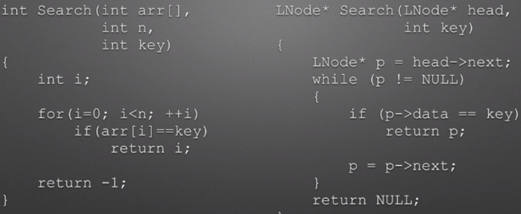

# JDK21 新特性

JDK 21 于 2023 年 9 月 19 日 发布，这是一个非常重要的版本，里程碑式。

JDK 21 是 LTS（长期支持版），至此为止，目前有 JDK8、JDK11、JDK17 和 JDK21 这四个长期支持版了。

JDK 21 共有 15 个新特性，这篇文章会挑选其中较为重要的一些新特性进行详细介绍：

* [JEP 430：String Templates（字符串模板）](https://openjdk.org/jeps/430)（预览）
* [JEP 431：Sequenced Collections（序列化集合）](https://openjdk.org/jeps/431)
* [JEP 439：Generational ZGC（分代 ZGC）](https://openjdk.org/jeps/439)
* [JEP 440：Record Patterns（记录模式）](https://openjdk.org/jeps/440)
* [JEP 441：Pattern Matching for switch（switch 的模式匹配）](https://openjdk.org/jeps/442)
* [JEP 442：Foreign Function & Memory API（外部函数和内存 API）](https://openjdk.org/jeps/442)（第三次预览）
* [JEP 443：Unnamed Patterns and Variables（未命名模式和变量](https://openjdk.org/jeps/443)（预览）
* [JEP 444：Virtual Threads（虚拟线程）](https://openjdk.org/jeps/444)
* [JEP 445：Unnamed Classes and Instance Main Methods（未命名类和实例 main 方法 ）](https://openjdk.org/jeps/445)（预览）

## JEP 430：字符串模板（预览）

String Templates(字符串模板) 目前仍然是 JDK 21 中的一个预览功能。

String Templates 提供了一种更简洁、更直观的方式来动态构建字符串。通过使用占位符`${}`，我们可以将变量的值直接嵌入到字符串中，而不需要手动处理。在运行时，Java 编译器会将这些占位符替换为实际的变量值。并且，表达式支持局部变量、静态/非静态字段甚至方法、计算结果等特性。

实际上，String Templates（字符串模板）再大多数编程语言中都存在:

```JavaScript
"Greetings {{ name }}!";  //Angular
`Greetings ${ name }!`;    //Typescript
$"Greetings { name }!"    //Visual basic
f"Greetings { name }!"    //Python
```

Java 在没有 String Templates 之前，我们通常使用字符串拼接或格式化方法来构建字符串：

```Java
public static void main(String[] args) {
    historyExample("士兵76");
}

/**
 * JDK 21 之前的字符串拼接方式
 *
 * @param name 要拼接的名称
 */
public static void historyExample(String name) {
    String message = "";
    // concatenation
    message = "Greetings " + name + "!";
    System.out.println(message);

    // String.format()
    message = String.format("Greetings %s!", name);
    System.out.println(message);

    // MessageFormat
    message = new MessageFormat("Greetings {0}!").format(new Object[]{name});
    System.out.println(message);

    // StringBuilder
    message = new StringBuilder().append("Greetings ").append(name).append("!").toString();
    System.out.println(message);
}
```

这些方法或多或少都存在一些缺点，比如难以阅读、冗长、复杂。

Java 使用 String Templates 进行字符串拼接，可以直接在字符串中嵌入表达式，而无需进行额外的处理：

```Java
String message = STR."Greetings \{name}!";
```

在上面的模板表达式中：

* STR 是模板处理器。
* `\{name}`为表达式，运行时，这些表达式将被相应的变量值替换。

Java 目前支持三种模板处理器：

* STR：自动执行字符串插值，即将模板中的每个嵌入式表达式替换为其值（转换为字符串）。
* FMT：和 STR 类似，但是它还可以接受格式说明符，这些格式说明符出现在嵌入式表达式的左边，用来控制输出的样式。
* RAW：不会像 STR 和 FMT 模板处理器那样自动处理字符串模板，而是返回一个 `StringTemplate` 对象，这个对象包含了模板中的文本和表达式的信息。

```TypeScript
public static void main(String[] args) {
    newExample("温斯顿");
}

/**
 * JDK 21 使用 String Templates 进行字符串拼接
 *
 * @param name 要拼接的名称
 */
public static void newExample(String name) {
    String message = "";

    //STR
    message = STR."Greetings \{name}.";
    System.out.println(message);

    //FMT
    message = FMT."Greetings %-12s\{name}.";
    System.out.println(message);

    //RAW
    StringTemplate st = RAW."Greetings \{name}.";
    message = STR.process(st);
    System.out.println(message);
}
```

除了 JDK 自带的三种模板处理器外，你还可以实现 `StringTemplate.Processor` 接口来创建自己的模板处理器，只需要继承 `StringTemplate.Processor`接口，然后实现 `process` 方法即可。

我们可以使用局部变量、静态/非静态字段甚至方法作为嵌入表达式：

```Java
//variable
message = STR."Greetings \{name}!";

//method
message = STR."Greetings \{getName()}!";

//field
message = STR."Greetings \{this.name}!";
```

还可以在表达式中执行计算并打印结果：

```Java
int x = 10, y = 20;
String s = STR."\{x} + \{y} = \{x + y}";  //"10 + 20 = 30"
```

为了提高可读性，我们可以将嵌入的表达式分成多行:

```Java
String time = STR."The current time is \{
    //sample comment - current time in HH:mm:ss
    DateTimeFormatter
      .ofPattern("HH:mm:ss")
      .format(LocalTime.now())
  }.";
```

### 预览功能，默认情况下禁用

https://zhuanlan.zhihu.com/p/27816600783

## JEP431：序列化集合

JDK 21 引入了一种新的集合类型：**Sequenced Collections（****序列化****&#x96C6;合，也叫有序集合）**，这是一种具有确定出现顺序（encounter order）的集合（无论我们遍历这样的集合多少次，元素的出现顺序始终是固定的）。序列化集合提供了处理集合的第一个和最后一个元素以及反向视图（与原始集合相反的顺序）的简单方法。

Sequenced Collections 包括以下三个接口：

* `SequencedCollection`
* `SequencedSet`
* `SequencedMap`

`SequencedCollection` 接口继承了 `Collection`接口， 提供了在集合两端访问、添加或删除元素以及获取集合的反向视图的方法。

```Java
interface SequencedCollection<E> extends Collection<E> {

  // New Method

  SequencedCollection<E> reversed();

  // Promoted methods from Deque<E>

  void addFirst(E);
  void addLast(E);

  E getFirst();
  E getLast();

  E removeFirst();
  E removeLast();
}
```

`List` 和 `Deque` 接口实现了`SequencedCollection` 接口。

这里以 `ArrayList` 为例，演示一下实际使用效果：

```Java
ArrayList<Integer> arrayList = new ArrayList<>();

arrayList.add(1);   // List contains: [1]

arrayList.addFirst(0);  // List contains: [0, 1]
arrayList.addLast(2);   // List contains: [0, 1, 2]

Integer firstElement = arrayList.getFirst();  // 0
Integer lastElement = arrayList.getLast();  // 2

List<Integer> reversed = arrayList.reversed();
System.out.println(reversed); // Prints [2, 1, 0]
```

## JEP 444：虚拟线程

虚拟线程（Virtual Thread）是 JDK 而不是 OS 实现的轻量级线程(Lightweight Process，LWP），由 JVM 调度。许多虚拟线程共享同一个操作系统线程，虚拟线程的数量可以远大于操作系统线程的数量。

在引入虚拟线程之前，`java.lang.Thread` 包已经支持所谓的平台线程，也就是没有虚拟线程之前，我们一直使用的线程。JVM 调度程序通过平台线程（载体线程）来管理虚拟线程，一个平台线程可以在不同的时间执行不同的虚拟线程（多个虚拟线程挂载在一个平台线程上），当虚拟线程被阻塞或等待时，平台线程可以切换到执行另一个虚拟线程。

虚拟线程、平台线程和系统内核线程的关系图如下所示（图源：[How to Use Java 19 Virtual Threads](https://medium.com/javarevisited/how-to-use-java-19-virtual-threads-c16a32bad5f7)）：



关于平台线程和系统内核线程的对应关系多提一点：在 Windows 和 Linux 等主流操作系统中，Java 线程采用的是一对一的线程模型，也就是一个平台线程对应一个系统内核线程。Solaris 系统是一个特例，HotSpot VM 在 Solaris 上支持多对多和一对一。具体可以参考 R 大的回答: [JVM 中的线程模型是用户级的么？](https://www.zhihu.com/question/23096638/answer/29617153)。

相比较于平台线程来说，虚拟线程是廉价且轻量级的，使用完后立即被销毁，因此它们不需要被重用或池化，每个任务可以有自己专属的虚拟线程来运行。虚拟线程暂停和恢复来实现线程之间的切换，避免了上下文切换的额外耗费，兼顾了多线程的优点，简化了高并发程序的复杂，可以有效减少编写、维护和观察高吞吐量并发应用程序的工作量。

虚拟线程在其他多线程语言中已经被证实是十分有用的，比如 Go 中的 Goroutine、Erlang 中的进程。

知乎有一个关于 Java 19 虚拟线程的讨论，感兴趣的可以去看看：https://www.zhihu.com/question/536743167 。

Java 虚拟线程的详细解读和原理可以看下面这几篇文章：

* [虚拟线程极简入门](https://javaguide.cn/java/concurrent/virtual-thread.html)
* [Java19 正式 GA！看虚拟线程如何大幅提高系统吞吐量](https://mp.weixin.qq.com/s/yyApBXxpXxVwttr01Hld6Q)
* [虚拟线程 - VirtualThread 源码透视](https://www.cnblogs.com/throwable/p/16758997.html)

虚拟线程在 Java 19 中进行了第一次预览，由[JEP 425](https://openjdk.org/jeps/425)提出。JDK 20 中是第二次预览，做了一些细微变化，这里就不细提了。

最后，我们来看一下四种创建虚拟线程的方法：

```Java
// 1、通过 Thread.ofVirtual() 创建
Runnable fn = () -> {
  // your code here
};

Thread thread = Thread.ofVirtual(fn)
                      .start();

// 2、通过 Thread.startVirtualThread() 、创建
Thread thread = Thread.startVirtualThread(() -> {
  // your code here
});

// 3、通过 Executors.newVirtualThreadPerTaskExecutor() 创建
var executorService = Executors.newVirtualThreadPerTaskExecutor();

executorService.submit(() -> {
  // your code here
});

class CustomThread implements Runnable {
  @Override
  public void run() {
    System.out.println("CustomThread run");
  }
}

//4、通过 ThreadFactory 创建
CustomThread customThread = new CustomThread();
// 获取线程工厂类
ThreadFactory factory = Thread.ofVirtual().factory();
// 创建虚拟线程
Thread thread = factory.newThread(customThread);
// 启动线程
thread.start();
```

通过上述列举的 4 种创建虚拟线程的方式可以看出，官方为了降低虚拟线程的门槛，尽力复用原有的 `Thread` 线程类，这样可以平滑的过渡到虚拟线程的使用。

https://javaguide.cn/java/new-features/java21.html

https://blog.csdn.net/finally\_vince/article/details/136471101
