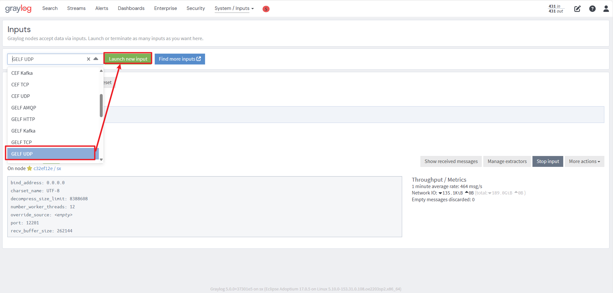
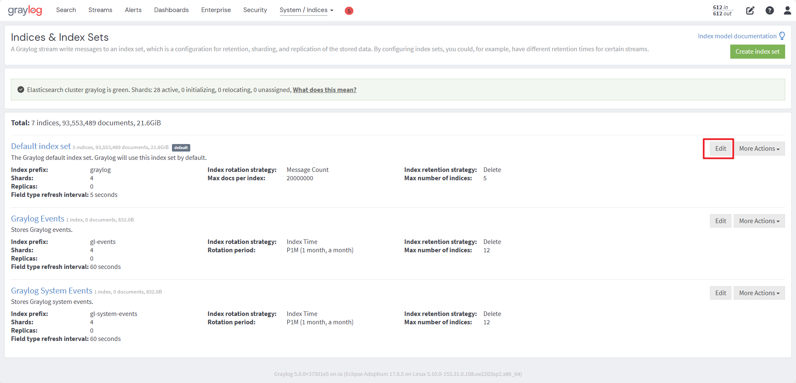
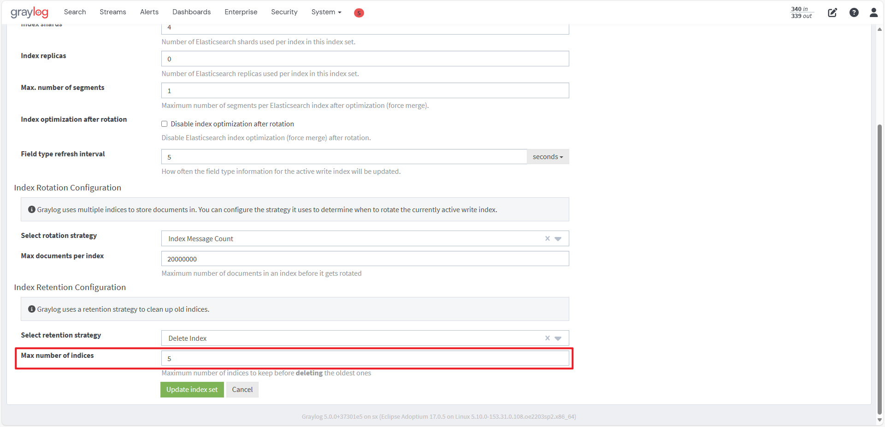

# Spring Boot 集成 Graylog

## 一、什么是 Graylog？

Graylog = **ELK 的替代方案**

更轻量、更简单、更稳定，专门做**日志集中收集、查询、告警**。

Spring Boot 对接 Graylog **使用 GELF 协议**（Graylog 专用格式）。

### Graylog 支持4 种常用日志收集方式

1. **GELF（推荐，SpringBoot 专用）**
   结构化日志、支持自定义字段、性能最好
2. **Syslog**
   系统日志、Linux 日志
3. **Beats / FileBeat**
   日志文件采集
4. **HTTP RAW**
   接口推送

### Graylog和ELK的简单对比

https://blog.csdn.net/xiaoye319/article/details/124025350

## 二、Docker Compose 一键部署 Graylog

Docker Compose部署Graylog：[点击访问](https://gitee.com/xu_xiaolong/docker-compose/blob/master/compose/graylog/docker-compose-graylog.yml)

### 2.1. 创建 `docker-compose.yml`

```yaml
version: '3'
services:
  mongodb:
    image: mongo:5.0
    restart: always
    volumes:
      - ./mongodb_data:/data/db
  elasticsearch:
    image: docker.elastic.co/elasticsearch/elasticsearch-oss:7.10.2
    restart: always
    volumes:
      - ./es_data:/usr/share/elasticsearch/data
    environment:
      - http.host=0.0.0.0
      - transport.host=localhost
      - network.host=0.0.0.0
      - xpack.security.enabled=false
      - "ES_JAVA_OPTS=-Xms512m -Xmx512m"
  graylog:
    image: graylog/graylog:5.0
    restart: always
    depends_on:
      - mongodb
      - elasticsearch
    ports:
      - "9000:9000"    # web ui
      - "12201:12201/tcp" # GELF TCP
      - "12201:12201/udp" # GELF UDP
    environment:
      - GRAYLOG_PASSWORD_SECRET=somepasswordpepper
      - GRAYLOG_ROOT_PASSWORD_SHA2=8c6976e5b5410415bade348ee2045b87d22ef9ac30c031dc6bd91fbf03934853
      - GRAYLOG_HTTP_EXTERNAL_URI=http://127.0.0.1:9000/
      - GRAYLOG_ROOT_TIMEZONE=Asia/Shanghai
```

### 2.2. 启动

```sh
docker-compose up -d
```

### 2.3. 访问 Graylog

```sh
http://localhost:9000
账号：admin
密码：admin
```

### 2.4. 创建 GELF 输入



1. 进入 Graylog → **System / Inputs**
2. 选择 **GELF UDP** → **Launch new input**
3. 名称随便填，启动
4. 端口：**12201**

### 2.5. 过期策略（可选）





1. 进入 Graylog → **System / Indices**
2. 选择 **Default index set**→ **Edit**
3. 配置 **Max number of indices** 数量

## 三、Spring Boot 集成 Graylog

使用 **logback + gelfappender** 推送日志。

### 3.1. pom.xml 依赖

```xml
<!-- logback-gelf -->
<dependency>
    <groupId>de.siegmar</groupId>
    <artifactId>logback-gelf</artifactId>
    <version>4.0.0</version>
</dependency>
```

### 3.2. logback.xml 配置

#### 默认配置

```xml
<?xml version="1.0" encoding="UTF-8"?>
<configuration>
    <include resource="org/springframework/boot/logging/logback/defaults.xml"/>
    <include resource="org/springframework/boot/logging/logback/console-appender.xml"/>

    <!-- 应用名称 -->
    <property name="APP_NAME" value="my-springboot-app"/>
    <property name="DEFAULT_FILE_PATH" value="./logs/${APP_NAME}.log"/>

    <!-- Graylog GELF 配置 -->
    <appender name="GELF" class="de.siegmar.logbackgelf.GelfUdpAppender">
        <graylogHost>192.168.100.178</graylogHost>  <!-- Graylog地址 -->
        <graylogPort>12201</graylogPort>            <!-- GELF UDP端口 -->
        <maxChunkSize>1420</maxChunkSize>

        <encoder class="de.siegmar.logbackgelf.GelfEncoder">
            <includeRawMessage>true</includeRawMessage>
            <includeMarker>true</includeMarker>
            <includeMdcData>true</includeMdcData>
            <includeCallerData>true</includeCallerData>
            <includeRootCauseData>true</includeRootCauseData>
            <includeLevelName>true</includeLevelName>

            <shortPatternLayout class="ch.qos.logback.classic.PatternLayout">
                <pattern>%d{yyyy-MM-dd HH:mm:ss} [%thread] %-5level %logger{36} - %msg</pattern>
            </shortPatternLayout>

            <fullPatternLayout class="ch.qos.logback.classic.PatternLayout">
                <pattern>%d{yyyy-MM-dd HH:mm:ss} [%thread] %-5level %logger{50} - %msg%n</pattern>
            </fullPatternLayout>

            <!-- 自定义字段 -->
            <staticField>app_name:${APP_NAME}</staticField>
            <staticField>env:dev</staticField>
        </encoder>
    </appender>

    <!-- 根日志 -->
    <root level="INFO">
        <appender-ref ref="CONSOLE"/>
        <appender-ref ref="GELF"/>
    </root>
</configuration>
```

#### 动态配置版

application.yml

```
graylog: 
  host: 192.168.100.106
  port: 12201
```

logback.xml

```yaml
<?xml version="1.0" encoding="UTF-8"?>
<configuration scan="true" scanPeriod="60 seconds">
    <springProperty scope="context" name="graylogHost" source="graylog.host" defaultValue=""/>
    <springProperty scope="context" name="graylogPort" source="graylog.port" defaultValue=""/>
    <appender name="GELF" class="de.siegmar.logbackgelf.GelfUdpAppender">
        <!-- Graylog服务的地址 -->
        <graylogHost>${graylogHost}</graylogHost>
        <!-- UDP Input端口 -->
        <graylogPort>${graylogPort}</graylogPort>
        <!-- 最大GELF数据块大小（单位：字节），508为建议最小值，最大值为65467 -->
        <maxChunkSize>1508</maxChunkSize>
        <!-- 是否使用压缩 -->
        <useCompression>true</useCompression>
        <encoder class="de.siegmar.logbackgelf.GelfEncoder">
            <!-- 是否发送原生的日志信息 -->
            <includeRawMessage>false</includeRawMessage>
            <includeMarker>true</includeMarker>
            <includeMdcData>true</includeMdcData>
            <includeCallerData>false</includeCallerData>
            <includeRootCauseData>false</includeRootCauseData>
            <!-- 是否发送日志级别的名称，否则默认以数字代表日志级别 -->
            <shortPatternLayout class="ch.qos.logback.classic.PatternLayout">
                <pattern>%m%nopex</pattern>
            </shortPatternLayout>
            <fullPatternLayout class="ch.qos.logback.classic.PatternLayout">
                <pattern>%d - [%thread] %-5level %logger{35} - %msg%n</pattern>
            </fullPatternLayout>

            <!-- 配置应用名称（服务名称），通过staticField标签可以自定义一些固定的日志字段 -->
            <staticField>app_name:${project.name}</staticField>
        </encoder>
        <filter class="ch.qos.logback.classic.filter.LevelFilter">
            <level>info</level>
        </filter>
    </appender>

    <root level="info">
        <appender-ref ref="GELF"/>
    </root>
</configuration>
```

## 四、问题

### 4.1. 解决 logback 大量 XXX\_IS\_UNDEFINED 文件

logback出现大量XXX\_IS\_UNDEFINED日志文件的问题：https://blog.csdn.net/w1014074794/article/details/120738822

#### 原因

没有正确定义 **LOG\_FILE 或 APP\_NAME** 导致自动生成异常文件。

#### 解决方案

在 `application.yml` 中加：

```yaml
spring:
  application:
    name: my-app
logging:
  config: classpath:logback.xml
  file:
    name: ./logs/${spring.application.name}.log
```

或在 logback.xml 顶部加：

```xml
<property name="LOG_FILE" value="./logs/my-app.log"/>
```

## 五、Graylog 收集 MySQL 慢查询日志

Graylog2采集Mysql慢日志：https://zhuanlan.zhihu.com/p/113936683

### 5.1. 开启 MySQL 慢查询

```ini
slow_query_log = 1
long_query_time = 1
log_queries_not_using_indexes = 1
slow_query_log_file = /var/lib/mysql/slow.log
```

### 5.2. FileBeat 采集慢日志 → Graylog

FileBeat 输出配置：

```yaml
output:
  gelf:
    hosts: ["graylog:12201"]
```

### 5.3. Graylog 创建 INPUT

选择 **FileBeat / GELF** 即可。

## 参考资料

https://juejin.cn/post/7483145055239225378

https://blog.csdn.net/xiaoye319/article/details/124023907

Graylog 收集方式(Syslog、GELF)：https://zhuanlan.zhihu.com/p/25937785
