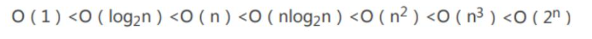
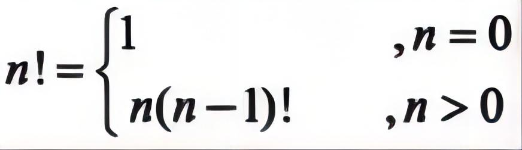
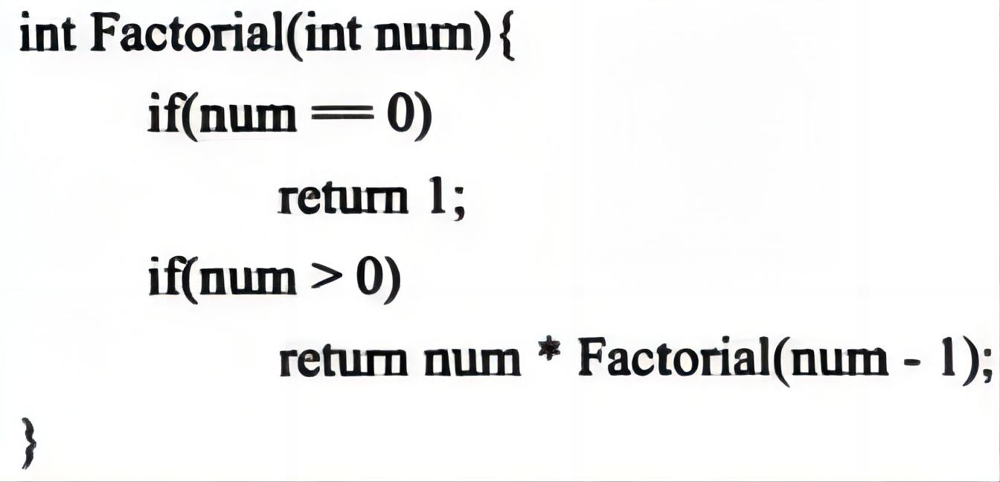
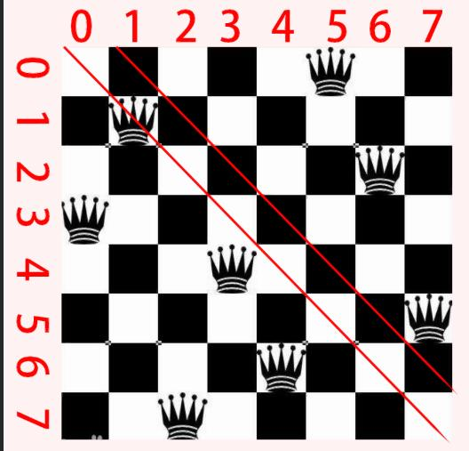
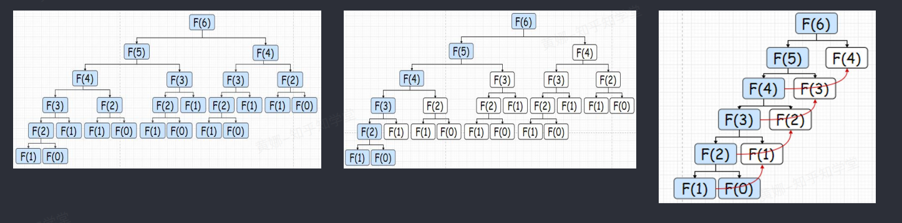
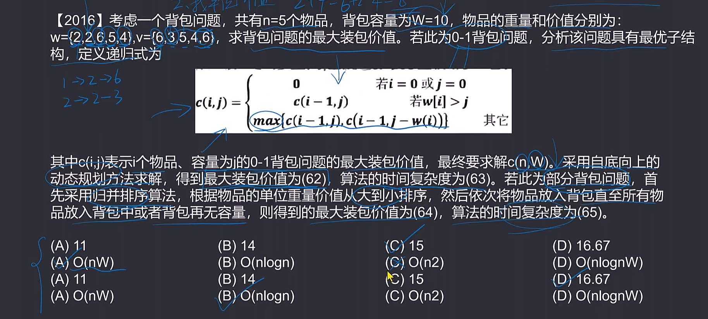
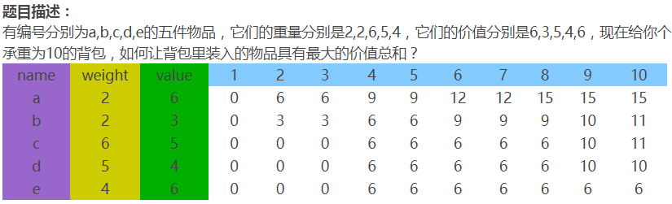
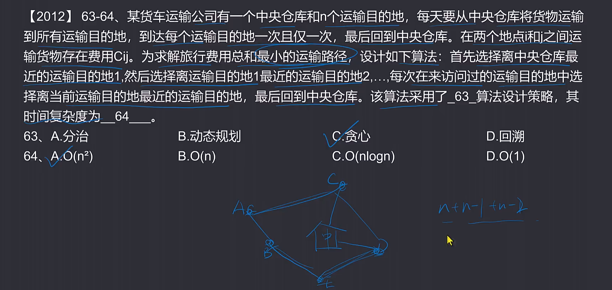
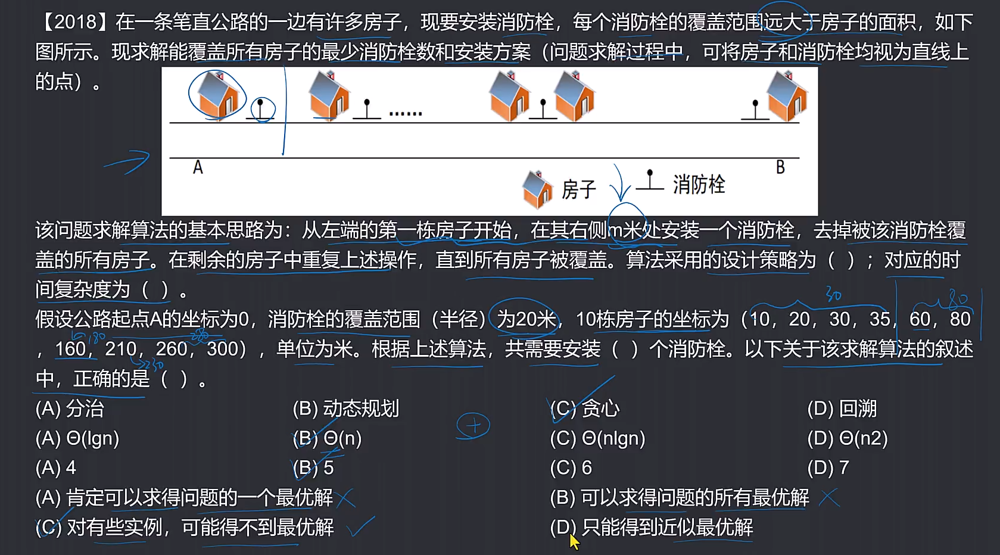

# 第8章 算法设计与分析

## 考点简介

### 🚀前言

算法设计与分析是计算机科学领域中的重要课题，主要涉及设计高效的算法，并对算法的时间复杂度和空间复杂度进行分析。通过算法设计与分析，可以提高算法的效率和性能，从而解决实际问题。

在算法设计中，需要考虑问题的特点和约束条件，选择合适的数据结构和算法思想，设计出解决问题的具体算法。常用的算法设计方法包括贪心算法、动态规划、分治算法、回溯算法等。

在算法分析中，主要关注算法的时间复杂度和空间复杂度。时间复杂度描述了算法执行所需的时间量级，而空间复杂度描述了算法执行所需的额外空间的量级。通过对算法的复杂度进行分析，可以评估算法的效率和性能，并选择合适的算法。

算法设计与分析在实际应用中非常重要，可以应用于各个领域，如图像处理、网络优化、数据挖掘、人工智能等。它不仅是计算机科学的核心内容，也是解决实际问题的关键步骤。

### 🚀一、算法设计与分析

#### 🔎1.算法设计与分析的基本概念

* 算法
* 算法设计
* 算法分析
* 算法的表示
* 自然语言
* 流程图
* 程序设计语言
* 伪代码

#### 🔎2.算法分析基础

* 时间复杂度
* 渐近符号
* 递归式

#### 🔎3.算法设计策略

* 分治法
* 贪心法
* 动态规划法
* 回溯法
* 分支限界法
* 概率算法
* 近似算法

#### 🔎4.数据挖掘算法

* 分类
* 频繁模式和关联规则挖掘
* 聚类

#### 🔎5.智能优化算法

* 概述
* 人工神经网络
* 遗传算法
* 模拟退火算法
* 禁忌搜索算法
* 蚁群算法
* 粒子群优化算法

### 🚀二、算法设计与分析

#### 🔎1.算法设计与分析的基本概念（15分）（重点）

算法设计与分析是计算机科学领域中的重要内容，涉及到计算机算法的设计、分析和优化。下面是与算法设计与分析相关的基本概念：

| 术语           | 定义                                                         |
| :------------- | :----------------------------------------------------------- |
| 算法           | 解决特定问题的一系列步骤和规则。描述了如何从输入数据中得出所需的输出结果。 |
| 时间复杂度     | 衡量了算法运行所需的时间。使用大O记号表示，表示算法执行时间随输入规模的增长速度。 |
| 空间复杂度     | 衡量了算法运行所需的内存空间。使用大O记号表示，表示算法所需内存随输入规模的增长速度。 |
| 渐进分析       | 一种评估算法复杂度的方法，关注算法在输入规模趋向无穷时的表现。 |
| 最优算法       | 在给定问题上运行时间最短或者占用空间最少的算法。             |
| 算法设计技巧   | 分治法、贪心法、动态规划、回溯法等用于解决不同类型问题的算法设计思想。 |
| 数据结构       | 一种用来组织和存储数据的方式。不同问题适用不同数据结构，如数组、链表、堆、栈、队列等。 |
| 分析算法正确性 | 验证算法是否能够按预期产生正确输出的过程。                   |
| 算法的可行性   | 算法是否可以在现有计算机或计算资源上运行。                   |
| 算法的可扩展性 | 算法是否可以在输入规模增大时仍能保持良好性能。               |

#### 🔎2.算法分析基础

算法分析基础是计算机科学中的一个重要概念，用于评估和比较不同算法的性能。它涉及到对算法的时间复杂度和空间复杂度进行分析和估计。

时间复杂度是衡量算法执行时间的度量，通常用大O符号表示。它描述了算法在处理输入数据规模增大时所需的操作次数。具体来说，时间复杂度指的是算法执行的基本操作次数，以及这些操作在最坏情况下的执行时间。

空间复杂度是衡量算法所需存储空间的度量，也用大O符号表示。它描述了算法在处理输入数据规模增大时所需的额外存储空间。具体来说，空间复杂度指的是算法执行过程中所使用的额外存储空间，包括变量、数组、堆栈等。

通过对算法的时间复杂度和空间复杂度进行分析，可以评估算法的效率和可行性。一般来说，时间复杂度越低、空间复杂度越低的算法，运行速度越快，资源消耗越少。因此，在设计和选择算法时，算法分析基础是一个重要的参考依据。

除了时间复杂度和空间复杂度，算法分析基础还涉及其他方面，如算法的正确性、稳定性、可扩展性等。这些综合的评估指标可以帮助开发者选择最适合的算法，提高程序的性能和效率。

#### 🔎3.算法设计策略

在算法设计过程中，有许多不同的策略可以选择。以下是一些常见的算法设计策略：

| 算法类型     | 算法解释                                                 | 优点                                             | 缺点                                                         |
| :----------- | :------------------------------------------------------- | :----------------------------------------------- | :----------------------------------------------------------- |
| 贪心算法     | 每次选择局部最优解，逐步迭代求解问题                     | 高效性                                           | 不能保证找到全局最优解                                       |
| 分治算法     | 将问题分解为多个子问题，递归解决并合并子问题的解         | 适用于可划分为多个子问题的问题                   | 递归过程中可能出现重复计算，需要额外的合并操作               |
| 动态规划     | 将问题分解为多个子问题，使用表格存储中间结果进行逐步计算 | 可以减少重复计算，适用于具有重叠子问题结构的问题 | 需要额外空间存储中间结果，可能存在计算顺序依赖性，需要找到最优子结构 |
| 回溯算法     | 通过尝试不同的选择来求解问题，通常使用递归实现           | 可以枚举所有可能解，适用于可以穷举所有解的问题   | 可能存在大量的重复计算，搜索空间较大时耗时较长               |
| 分支限界算法 | 维护候选解集合，优先选择最有希望的候选解扩展搜索空间     | 可以通过界限函数剪枝搜索树，提高搜索效率         | 最优解可能仍需要枚举所有解，界限函数的设计可能非常复杂       |
| 随机化算法   | 使用随机数引入随机性，随机探索解空间以期望找到更好的解   | 可以避免陷入局部最优解，具有一定的随机性         | 结果可能不稳定，运行时间不确定，可能需要多次运行来获得更好的结果 |

#### 🔎4.数据挖掘算法

数据挖掘算法是用来发现和提取大量数据中隐藏的、有用的信息和模式的方法和技术。以下是一些常见的数据挖掘算法：

| 算法名称       | 描述                                                         |
| :------------- | :----------------------------------------------------------- |
| 决策树算法     | 通过构建一颗二叉树来进行分类或预测，树的每个内部节点表示一个属性，每个叶节点表示一个类别或预测结果。 |
| 随机森林算法   | 通过集成多颗决策树来进行分类或预测，每棵树的结果取决于一个随机选择的样本和随机选择的特征。 |
| 支持向量机算法 | 通过将样本映射到高维空间，并在此空间中寻找一个最优的超平面来进行分类。 |
| 聚类算法       | 将相似的样本划分到同一类别中，常见的聚类算法有K-means和层次聚类。 |
| 关联规则挖掘   | 发现数据中的频繁项集和关联规则，常用的算法有Apriori和FP-growth。 |
| 神经网络算法   | 通过构建一个由神经元组成的网络来进行分类或预测，常见的神经网络算法有多层感知器（MLP）和卷积神经网络（CNN）。 |
| 常用性能指标   | 精确率、召回率、F1值、准确率、AUC等。                        |

#### 🔎5.智能优化算法

智能优化算法是一种基于人工智能和优化算法的算法，主要用于解决复杂问题的优化和搜索。智能优化算法模拟生物进化、群体行为等自然现象，通过不断迭代和调整，寻找到最优解或近似最优解。

常见的智能优化算法包括遗传算法、粒子群优化算法、蚁群算法、人工免疫算法等。这些算法不同于传统的数学优化方法，其思想是通过模仿自然界中的生物行为或者群体智能，以一种分布式、并行的方式进行搜索和优化。

智能优化算法适用于各种优化问题，包括函数优化、参数优化、组合优化等。它具有对问题进行全局搜索的能力，能够找到全局最优解或者接近最优解。与传统优化算法相比，智能优化算法更加灵活、鲁棒性强，并且可以处理复杂、非线性、多模态的问题。

智能优化算法在许多领域有广泛的应用，包括机器学习、数据挖掘、工程优化、交通规划、金融风险管理等。它可以帮助我们在复杂的问题中找到最优解，提高效率和效果。

## 算法分析基本概念与算法分析基础

### 🚀前言

算法在现实中有许多应用场景，以下是其中的一些例子：

| 应用场景   | 算法                                     |
| :--------- | :--------------------------------------- |
| 搜索引擎   | PageRank算法、TF-IDF算法                 |
| 推荐系统   | 协同过滤算法、基于内容的推荐算法         |
| 图像处理   | Canny边缘检测算法、Haar特征检测算法      |
| 机器学习   | 神经网络、决策树、支持向量机             |
| 路径规划   | Dijkstra算法、A\*算法                     |
| 数据压缩   | Huffman编码、Lempel-Ziv-Welch（LZW）算法 |
| 调度和优化 | 贪心算法、动态规划                       |

这只是一小部分算法在现实中的应用场景，实际上算法在各个领域都有广泛的应用。算法的目标是提高效率、减少资源消耗、优化结果等，为我们的现实生活和计算机应用提供了重要的支持。

### 🚀一、算法分析基本概念

#### 🔎1.算法的概念

算法是用于解决问题或执行任务的一系列有序步骤的描述。它描述了在给定输入条件下，计算机应该如何进行操作来产生所需的输出结果。算法可以看作是问题解决的具体步骤，它是一种确定性的过程，通过一系列指令来处理输入数据并产生输出结果。

一个好的算法应该具备以下特点：

| 特性   | 描述                                                         |
| :----- | :----------------------------------------------------------- |
| 有穷性 | 算法在执行有穷步之后必须结束，并且每一步都可以在有穷时间内完成。 |
| 确定性 | 算法中的每一条指令必须有确切的含义，没有二义性，并且对于相同的输入只会得出唯一的输出。 |
| 可行性 | 算法中描述的操作都可以通过已经实现的基本运算执行有限次来实现。 |
| 输入   | 一个算法可以有零个或多个输入，这些输入来自于某个特定对象的集合。 |
| 输出   | 一个算法可以有一个或多个输出，这些输出与输入有着特定关系。   |

算法可以用自然语言、图表、伪代码或编程语言等方式进行描述和表示。它在计算机科学中起着至关重要的作用，是构建各种应用程序和系统的基础。

#### 🔎2.算法的表示

常用的表示算法的方法有自然语言、流程图、程序设计语言和伪代码等

| 方法         | 描述                                                         |
| :----------- | :----------------------------------------------------------- |
| 自然语言     | 优点是容易理解，缺点是容易出现二义性，并且算法通常很冗长。   |
| 流程图       | 优点是直观易懂，缺点是严密性不如程序设计语言，灵活性不如自然语言。 |
| 程序设计语言 | 优点是能直接用计算机执行，缺点是抽象性差，会导致算法设计者忽略“好”算法和正确逻辑的重要性，并需要掌握编程技巧和语言。 |
| 伪代码       | 伪代码介于自然语言和程序设计语言之间，结合某一程序设计语言的基本语法，同时采用自然语言来表达，可以最简明扼要地表达一个给定的算法。 |

### 🚀二、算法分析基础

算法复杂性包括两个方面，一个是算法效率的度量（时间复杂度），一个是算法运行所需要的计算机资源量的度量（空间复杂度），这也是评价算法优劣的重要依据。

#### 🔎1.时间复杂度

一个程序的时间复杂度是指程序运行从开始到结束所需要的时间。通常分析时间复杂度的方法是从算法中选取一种对于所研究的问题来说是基本运算的操作，以该操作重复执行的次数作为算法的时间度量。一般来说，算法中原操作重复执行的次数是规模n的某个函数T（n）。由于许多情况下要精确计算T（n）是困难的，因此引入了渐进时间复杂度在数量上估计一个算法的执行时间。

我们通常使用"O（）"来表示时间复杂度，其定义如下：如果存在两个正常数c和m，对于所有的n，当n≥m时有f（n）≤cg（n），则有f（n）=O（g（n））也就是说，随着n的增大，f（n）渐进地不大于g（n）。例如，一个程序的实际执行时间为3n^3+2n^2+n,则T（n）=O（n^3）。T（n）和n^3的值随n的增长渐近地靠拢。常见的渐进时间复杂度有：



时间复杂度是一种用于衡量算法运行时间的度量方法，它表示随着输入规模的增加，算法所需的时间增长的趋势。

时间复杂度通常用大O符号（O）来表示，它表示算法运行时间的上界。具体来说，如果一个算法的时间复杂度为O(f(n))，表示随着输入规模n的增加，算法最坏情况下的运行时间不会超过一个与f(n)成正比的函数。

以下是常见的时间复杂度及其示例：

1. 常数时间复杂度 O(1)：无论输入规模大小如何，操作所需的时间都是固定的。 示例：访问数组中的某个元素。
2. 线性时间复杂度 O(n)：随着输入规模n的增加，算法需要的时间正比于n。 示例：遍历一个长度为n的数组。
3. 对数时间复杂度 O(log n)：随着输入规模n的增加，算法需要的时间增长缓慢，增长速度小于线性时间复杂度。 示例：二分查找算法。
4. 线性对数时间复杂度 O(n log n)：随着输入规模n的增加，算法需要的时间增长更快一些，但增长速度小于平方时间复杂度。 示例：快速排序算法、归并排序算法。
5. 平方时间复杂度 O(n^2)：随着输入规模n的增加，算法需要的时间呈平方级增长。 示例：冒泡排序算法、选择排序算法。
6. 指数时间复杂度 O(2^n)：随着输入规模n的增加，算法需要的时间呈指数级增长。 示例：旅行商问题的穷举解法。

在实际应用中，我们希望选择时间复杂度较低的算法来解决问题，以提高算法的效率和性能。因此，正确评估和理解算法的时间复杂度至关重要。

#### 🔎2.空间复杂度

空间复杂度是指算法在运行过程中所需要的额外的空间资源的量度。常用的空间复杂度的表示方法有O(1)、O(n)、O(n²)等。

一个程序的空间复杂度是指程序运行从开始到结束所需的存储量。它通常包括固定部分和可变部分两个部分。

例如，计算一个整数数组的总和，可以使用一个额外的变量来保存累加的结果，此时空间复杂度为O(1)。

再例如，对于一个长度为n的整数数组，如果创建一个相同长度的新数组来存储每个元素的平方，则空间复杂度为O(n)。

#### 🔎3.度量

常见的对算法执行所需时间的度量：`O(1) < O(log2n) <O(n) < O(nlog2n) < O(n²) < O(n³) < O(2ⁿ) < O(n!)`

上述的时间复杂度，经常考到，需要注意的是，时间复杂度是一个大概的规模表示，一般以循环次数表示，O(n)说明执行时间是n的正比，另外，log对数的时间复杂度一般在查找二叉树的算法中出现。渐进符号O表示一个渐进变化程度，实际变化必须小于等于O括号内的渐进变化程度。

## 分治法和回溯法

### 🚀前言

分治法和回溯法都是常见的算法思想，它们在解决问题时有些相似，但也有一些不同之处。

1. 分治法：分治法是将问题分解成更小的子问题，并且递归地解决子问题，最后将子问题的解合并成原问题的解。分治法的基本思想是将问题划分成互不重叠的子问题，然后对子问题进行求解，最后再将子问题的解合并成原问题的解。分治法通常用于解决可以被分为多个独立子问题的问题，如归并排序和快速排序。
2. 回溯法：回溯法也是一种递归算法，它通过试探和回溯的方式搜索问题的解空间。回溯法的基本思想是从问题的一个初始解出发，逐步构造问题的解，当不能继续构造时，就进行回溯，返回上一层继续构造。回溯法通常用于解决在一组可能的解中找出特定解的问题，如八皇后问题和0-1背包问题。

分治法更注重将问题分解成独立的子问题，并通过将子问题的解合并来得到原问题的解，时间复杂度较低；而回溯法更注重尝试和回溯的过程，在解空间中搜索符合条件的解，可能需要遍历所有的可能解，时间复杂度较高。在选择使用哪种算法思想时，需要根据具体问题的特点和要求进行选择。

在算法的分析与设计中，经常会发现时间复杂度和空间复杂度之间有着微妙的关系，经常可以相互转换，也就是可以利用空间来换时间，也可以用时间来换空间。

### 🚀一、分治法

#### 🔎1.概念

分治法：对于一个规模为n的问题，若该问题可以容易地解决则直接解决；否则将其分解为k个规模较小的子问题，这些子问题互相独立且与原问题形式相同，递归地解决这些子问题，然后将各子问题的解合并得到原问题的解。

步骤：分解(将原问题分解成一系列子问题)——求解(递归地求解各子问题，若子问题足够小，则直接求解)——合并(将子问题的解合并成原问题的解)。

凡是涉及到分组解决的都是分治法(二分查找、归并排序、求阶乘、斐波那契数列等)。

#### 🔎2.案例

##### 🦋2.1 二分查找

二分查找是一种在有序数组中查找特定元素的算法。它的基本思想是通过将数组分成两部分，判断目标元素在哪一部分中，然后继续在该部分中进行查找，直到找到目标元素或者确定目标元素不存在为止。

二分查找的算法如下：

1. 初始化左指针left为0，右指针right为数组长度减1。
2. 循环执行下列步骤：
3. 计算中间位置mid，mid等于左指针left和右指针right之和除以2。
4. 如果目标元素等于中间位置的元素，则返回中间位置。
5. 如果目标元素小于中间位置的元素，则将右指针right更新为mid-1。
6. 如果目标元素大于中间位置的元素，则将左指针left更新为mid+1。
7. 如果循环结束时仍未找到目标元素，则返回-1，表示目标元素不存在。

##### 🦋2.2 归并排序

归并排序是一种分治算法，它将一个数组分成两个子数组，分别对子数组进行排序，然后将两个有序子数组合并为一个有序数组。归并排序的基本思想是将一个大问题分解成两个小问题，然后递归地解决这两个小问题。

归并排序的算法如下：

1. 如果数组长度小于等于1，则返回。
2. 将数组分成两个子数组，分别对每个子数组递归地进行归并排序。
3. 将两个有序子数组合并为一个有序数组。

##### 🦋2.3 求阶乘

求阶乘是一种求解自然数的阶乘的算法。阶乘的定义是n! = n  *(n-1)*  (n-2)  *...*  1。求阶乘的算法可以通过递归的方式来实现，即将问题分解为更小的子问题。

求阶乘的算法如下：

1. 如果n等于0或1，则返回1。
2. 否则，将问题分解为求解(n-1)!，然后将结果乘以n。





##### 🦋2.4 斐波那契数列

斐波那契数列是一种数列，其前两个数字为0和1，后续数字为前两个数字之和。斐波那契数列的递推公式为f(n) = f(n-1) + f(n-2)，其中f(0) = 0，f(1) = 1。

求解斐波那契数列的算法可以通过递归的方式来实现，即将问题分解为求解f(n-1)和f(n-2)。

求解斐波那契数列的算法如下：

1. 如果n等于0，则返回0。
2. 如果n等于1，则返回1。
3. 否则，将问题分解为求解f(n-1)和f(n-2)，然后将结果相加。

### 🚀二、回溯法

#### 🔎1.概念

回溯法（Backtracking）是一种选优的暴力搜寻法。但是，由于暴力，回溯法的时间复杂度较高，又称为试探法，按选优条件向前搜索，以达到目标。但当探索到某一步时，发现原先选择并不优或达不到目标，就退回一步重新选择，这种走不通就退回再走的技术为回溯法，而满足回溯条件的某个状态的点称为“回溯点”。

一般用于解决迷宫类的问题。其思路不难理解，想象一下你在走一个迷宫，当在一个路口有A， B， C 三条岔路的时候你要怎么办呢？ 大家可以很容易地想到先尝试道路A， 如果走不通就回到这个路口尝试道路B，如果还走不通就尝试道路C，这就是一个典型地应用回溯法的例子。如果将目光着眼于整个迷宫，就可以发现这个迷宫其实就是一颗多叉树，每个路口就是一个节点，每个路口的岔路就是这个节点的子树，在这颗多叉树上应用深度优先搜索就是回溯法。


#### 🔎2.案例

回溯法是一种递归的算法思想，常用于解决一些组合问题，比如求解排列、组合、子集等。

下面是一个回溯法的经典案例——八皇后问题。

八皇后问题是一个经典的问题，要求在一个8×8的棋盘上放置8个皇后，使得任意两个皇后都不能在同一行、同一列或同一对角线上。

具体的回溯算法思路如下：

1. 定义一个长度为8的数组queen，用来记录每行皇后的列位置。
2. 从第一行开始，逐行放置皇后。
3. 对于每一行，依次尝试在每一列放置皇后。
4. 判断当前位置是否与已放置的皇后冲突，如果冲突则尝试下一列。
5. 如果找到一个合适的位置，则记录当前位置，并递归地继续放置下一行的皇后。
6. 如果找不到一个合适的位置，则返回上一行，回溯到上一个位置继续尝试下一列。
7. 当放置完8个皇后后，得到一个解，输出解的位置。

以下是一个python代码实现：

```python
def solve_n_queens():
    queen = [-1] * 8  # 存放每行皇后的列位置
    
    def is_conflict(row, col):
        # 判断当前位置与已放置的皇后是否冲突
        for i in range(row):
            if queen[i] == col or \
                queen[i] - i == col - row or \
                queen[i] + i == col + row:
                return True
        return False
    
    def backtrack(row):
        # 回溯函数
        if row == 8:
            # 找到一个解，输出位置
            print(queen)
            return
        
        for col in range(8):
            if not is_conflict(row, col):
                # 当前位置不冲突，记录位置并继续放置下一行的皇后
                queen[row] = col
                backtrack(row + 1)
                # 回溯，尝试下一列
                queen[row] = -1
    
    backtrack(0)  # 从第一行开始放置皇后


solve_n_queens()
```

运行上述代码，可以得到八皇后问题的全部解：

```bash
[0, 4, 7, 5, 2, 6, 1, 3]
[0, 5, 7, 2, 6, 3, 1, 4]
[0, 6, 3, 5, 7, 1, 4, 2]
[0, 6, 4, 7, 1, 3, 5, 2]
[1, 3, 5, 7, 2, 0, 6, 4]
[1, 4, 6, 0, 2, 7, 5, 3]
[1, 4, 6, 3, 0, 7, 5, 2]
[1, 5, 0, 6, 3, 7, 2, 4]
...
```



## 动态规划法和贪心法

### 🚀前言

动态规划法（Dynamic Programming）和贪心法（Greedy Algorithm）是两种常用的问题求解方法。它们在某些情况下可以互相替代，但在其他情况下则各有优势。

动态规划法是一种`将大问题拆分成更小的子问题`，并将子问题的解存储起来以避免重复计算的方法。它通常用于求解具有重叠子问题和最优子结构性质的问题。动态规划法的基本思想是，通过解决子问题找到问题的最优解，然后将子问题的解合并起来得到原问题的最优解。动态规划法的时间复杂度通常为O(n^2)或更低，但空间复杂度可能较高。

贪心法是一种贪心地进行选择，每次选择当前最优解的方法。贪心法通常适用于具有贪心选择性质的问题，即每一步都选择当前最优解能够得到全局最优解。贪心法的优点是简单且高效，时间复杂度通常为O(n)。然而，贪心法不能保证求解得到的解是全局最优解，因此在某些情况下可能会得到次优解或错误解。

动态规划法和贪心法的比较可以从以下几个方面进行：

1. 解决问题的类型：动态规划法适用于具有重叠子问题和最优子结构性质的问题，而贪心法适用于具有贪心选择性质的问题。
2. 解决问题的效率：动态规划法通常需要存储子问题的解，因此在空间上可能比较占用内存。而贪心法不需要存储子问题的解，因此在空间上相对较为节省。在时间效率上，动态规划法的时间复杂度通常为O(n^2)或更低，而贪心法的时间复杂度通常为O(n)。
3. 解决问题的保证性：动态规划法可以保证求解得到的解是全局最优解，而贪心法不能保证。因此，在需要保证求解结果为最优解的情况下，应使用动态规划法。

动态规划法和贪心法在解决问题时各有优势，应根据具体问题的性质选择合适的方法。如果问题具有重叠子问题和最优子结构性质，并且需要求解得到的是全局最优解，则应使用动态规划法。如果问题具有贪心选择性质，并且求解的结果不需要是全局最优解，则可以考虑使用贪心法。

### 🚀一、动态规划法

#### 🔎1.概念

动态规划法（Dynamic Programming）：在求解问题中，对于每一步决策，列出各种可能的局部解，通过决策保留那些有可能达到最优的局部解，丢弃其它局部解，以每一步都是最优解来保证
全局是最优解。

本质也是将复杂的问题划分成一个个子问题，**与分治法不同的是分治法中的每个子问题都是相同的，而动态规划法中的每个子问题间不是相互独立的，并且不全都相同**。

此算法会将大量精力放在前期构造表格上面，其会对每一步，列出各种可能的答案，这些答案会存储起来，最终要得出某个结果时，是通过查询这张表来得到的。

> **动态规划法不但每一步最优，全局也最优。**

总结：动态规划一定是具备了以下三个特点：

* 把原来的问题分解成了几个相似的子问题。（强调“相似子问题”）
* 所有的子问题都只需要解决一次。（强调“只解决一次”）
* 储存子问题的解。（强调“储存”）

#### 🔎2.案例

左下图是使用递归来求解的写法，显然，这是一个非常低效的方法，因为其中有大量的重复计算。并且不满足动态规划的第二个特点：“所有的子问题都只需要解决一次“，这个问题很好解决，我们只需要利用动态规划的第三个特点：”储存子问题的解“就可以了。比如，如果已经计算过Fibonacci(3)，那么把结果储存起来，其他地方碰到需要求Fibonacci(3)的时候，就不需要计算，直接调用结果就行。这样做之后，蓝色表示需要进行计算的，白色表示可以直接从存储中取得结果的：



### 🚀二、贪心法

#### 🔎1.概念

贪心法：总是做出在当前来说是最好的选择，而并不从整体上加以考虑，它所做的每步选择只是当前步骤的局部最优选择，但从整体来说不一定是最优的选择。由于它不比为了寻找最优解而穷尽所有可能解，因此其耗费时间少，一般可以快速得到满意的解，但得不到最优解。

局部贪心：只针对当前的步骤取最优，而非整体考虑。

判断此类算法，就看算法是否是每一步都取最优，并且整体题意没有透露出最终结果是最优的。

#### 🔎2.案例

假设你身上带了足够的1、5、10、20、50、100元面值的钞票。现在您的目标是凑出某个金额w，并且需要用到尽量少的钞票。依据生活经验，我们可以采取这样的策略：能用100的就尽量

用100的，否则尽量用50的……依次类推。在这种策略下，666=6×100+1×50+1×10+1×5+1×1，

共使用了10张钞票。这种策略称为“贪心”：假设我们面对的局面是“需要凑出w”，贪心策略会尽快

让w变得更小。能让w少100就尽量让它少100，这样我们接下来面对的局面就是凑出w-100。长期的生活经验表明，贪心策略是正确的。

如果我们换一组钞票的面值，贪心策略就也许不成立了。如果一个奇葩国家的钞票面

额分别是1、5、11，那么我们在凑出15的时候，贪心策略会出错：15=1×11+4×1 （贪心策略使用

了5张钞票），15=3×5 （正确的策略，只用3张钞票）

贪心策略的纲领是：“尽量使接下来面对的w更小”。这样，贪心策略在w=15的局面时，会优先使用11来把w降到4；但是在这个问题中，凑出4的代价是很高的，必须使用4×1。如果使用了5，w会降为10，虽然没有4那么小，但是凑出10只需要两张5元。在这里我们发现，贪心是一种只考虑眼前情况的策略。

### 🚀三、动态规划法结合贪心法

如果直接暴力枚举凑出w的方案，明显复杂度过高。太多种方法可以凑出w了，枚举它们的时

间是不可承受的。我们现在来尝试找一下性质。

　　重新分析刚刚的例子。w=15时，我们如果取11，接下来就面对w=4的情况；如果取5，则接

下来面对w=10的情况。我们发现这些问题都有相同的形式：

“给定w，凑出w所用的最少钞票是多少张？”接下来，我们用f(n)来表示“凑出n所需的最少钞票数量”。

　　那么，如果我们取了11，最后的代价（用掉的钞票总数）是多少呢？

　　明显cost=f(4)+1=4+1=5 ，它的意义是：利用11来凑出15，付出的代价等于f(4)加上自

己这一张钞票。现在我们暂时不管f(4)怎么求出来。

　　依次类推，马上可以知道：如果我们用5来凑出15，cost就是f(10)+1=2+1=3 。

　　那么，现在w=15的时候，我们该取那种钞票呢？当然是各种方案中，cost值最低的那一个

！

　　- 取11：cost=f(4)+1=4+1=5 　- 取5：  cost=f(10)+1=2+1=3 　- 取1：  cost=f(14)+1=4+1=5 　显而易见，cost值最低的是取5的方案。我们通过上面三个式子，做出了正确的决策！ 　这给了我们一个至关重要的启示—— f(n) 只与 f(n−1),f(n−5),f(n−11) 相关；更确切地说： 　　　f(n)=min{f(n-1),f(m-5),f(n-11)}+1 　这就是DP（动态规划，dynamic programming）将一个问题拆成几个子问题，分别求解这些子问题，即可推断出大问题的解。

### 🚀四、案例

#### 🔎1.背包问题



题目：考虑一个有n=5个物品的背包问题实例，背包的容量m=10，v(价值)=(6,3,5,4,6)，并且w(重量)=(2,2,6,5,4)，请问不超过sw（背包能承受的总重）的情况下，最大的放入价值是多少（）

【0-1背包问题】就是物品只能放一次，要么放要么不放。（动态规划）

【完全背包问题】物品可以无限放（贪心算法）

【多重背包问题】有n1个物品a1，n2个物品a2，放进背包里，可以转成0-1背包问题，相当于有

##### 🦋1.1 0-1背包问题



```java
public class Main {
    public static void main(String[] args) {
        int n = 5;
        int[] w = {2,2,6,5,4};
        int[] v = {6,3,5,4,6};
        int sw = 10;
        int[][] dp = new int[n][sw + 1];
        for (int i = 0; i <= sw; i++) {
            if (i < w[0]) {
                dp[0][i] = 0;
            } else {
                dp[0][i] = v[0];
            }
        }
        for (int i = 1; i < n; i++) {
            for (int j = 0; j <= sw; j++) {
                if (j < w[i]) {
                    dp[i][j] = dp[i-1][j];
                } else {
                    dp[i][j] = Math.max(dp[i-1][j], dp[i-1][j- w[i]] + v[i]);
                }
            }
        }
        System.out.println(dp[n-1][sw]);
    }
}
```

##### 🦋1.2 完全背包问题

|               | x1   | x2   | x3   | x4   | x5   |
| :------------ | :--- | :--- | :--- | :--- | :--- |
| 重量w         | 2    | 2    | 6    | 5    | 4    |
| 价值v         | 6    | 3    | 5    | 4    | 6    |
| 价值重量比V/W | 3    | 1.5  | 0.83 | 0.8  | 1.5  |

按价值重量比从大到小：x1、x2、x5、x3、x4

上界：按重量比从大到小放进去，x1、x2、x5都可以，直到x3时，背包剩余容量2、总价值为15，若将背包填满，则将x3放入重量为2即1/3，此时背包内总价值为15+5\*1/3=16.67；下界：每次放入价值最大的，直至放不进去，即6+6=12

#### 🔎2.运输问题



#### 🔎3.消防栓问题



## 参考资料

视频

希赛网

文字版

https://cloud.tencent.com/developer/article/2385825

https://cloud.tencent.com/developer/article/2387285

https://blog.csdn.net/chengsw1993/article/details/125714839

彻底搞懂回溯法：https://blog.csdn.net/m0\_52824954/article/details/123467217

kruskal算法：https://blog.csdn.net/Floatiy/article/details/79424763
